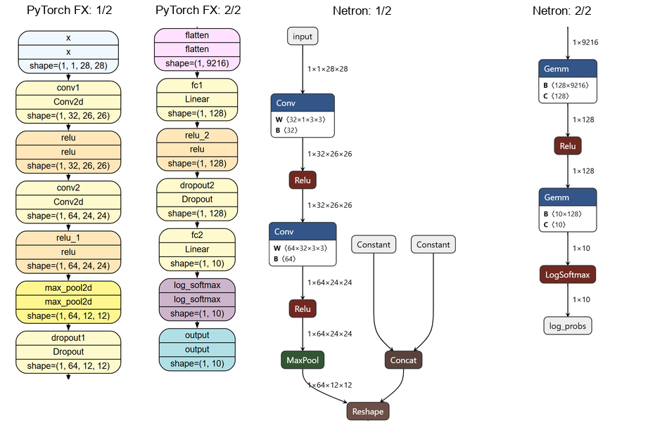

## 2.6 计算图、算子与模型结构

　　前面，我们已经训练、保存并使用了MNIST模型。一张28×28的灰度图片进入模型，最后得到10个分类输出。中间发生了什么？例如，全连接层为什么要接收9216个特征，而不是直接接收原图的像素？

　　本节沿用配套工程中的`Net`，沿着卷积、池化和全连接层追踪数据的变化，再对照源码和计算图，说明模型的输入、内部计算与输出。理解这些关系，也有助于检查交给其他软件运行的模型。这里先观察已经导出的ONNX文件，生成文件的方法放在2.7节。

### 2.6.1 计算图中的数据

　　先看`forward()`中的两行代码：

```python
x = self.conv1(x)  # 卷积产生新的特征图。
x = F.relu(x)     # 对特征图逐元素应用激活函数。
```

　　第二行使用第一行的计算结果。两行虽然都用x接收结果，数据却先经过卷积，再经过激活。画在图上，就是卷积的输出连接到激活的输入。

　　把模型中的计算按数据依赖连接起来，就得到计算图（computational graph）。图中的节点表示一次计算，例如卷积或激活；边表示计算之间的数据传递关系。沿着边传递的是张量，也就是前面介绍的多维数值数组。[来源：S02-002] 读图时，既要看节点执行什么运算，也要看连线上张量的形状和数据类型。

　　卷积除了接收图片，还需要训练得到的权重和偏置。当前模型的第一层权重形状为`[32,1,3,3]`：32组滤波器，每组接收1个输入通道，使用3×3卷积核；偏置形状为`[32]`。这些参数与图片一起参与计算，但已随模型保存，不必在每次推理时重新提供。[记录：M02-002]

　　卷积具体怎样计算？先把一个3×3卷积核放在图片的一块3×3区域上，将对应位置的像素值与权重相乘，把9个乘积相加，再加上这个滤波器的偏置，就得到一个输出值。卷积核沿图片移动，重复这一过程，形成一张特征图。第一层有32组滤波器，所以产生32个输出通道。第二层接收32个输入通道，每个输出通道需要把所有输入通道上的对应乘积一起求和，再加偏置，而不是分别处理后直接拼接。[来源：S02-007；记录：M02-001、M02-002]

　　在本例ONNX中，权重和偏置保存在初始化张量（initializer）中。初始化张量是图中预先保存的命名张量，常用于权重，也可以保存其他常量。卷积输出的特征图则要在图片进入模型后才能算出，属于中间张量。图中还可能出现`Constant`节点，它也能产生固定值，只是表达方式与初始化张量不同。[来源：S02-002；记录：M02-003] 读图时，应区分预先保存的参数、运行时算出的结果和用户提供的输入。

### 2.6.2 追踪张量形状

　　一张28×28灰度图片在本模型中表示为`[1,1,28,28]`：第一个1表示一张图片，第二个1表示一个灰度通道，后两个维度表示高度和宽度。这种排列顺序称为NCHW，四个字母依次对应批次大小（N）、通道数（C）、高度（H）和宽度（W）。张量的数据类型为float32，即每个元素用32位浮点数表示。[来源：S02-007；记录：M02-001、M02-003]

　　这张图片经过的主要操作见表2.6.1。先留意高度和宽度在哪些地方缩小，再看通道数和展平后的特征数量。表中形状来自模型定义、实际FX形状传播和ONNX图信息；两处Dropout均按评估模式解释。

<p align="center">表2.6.1 MNIST模型的主要操作与形状变化</p>

| PyTorch操作 | 本例ONNX表达 | 输出形状 |
| --- | --- | --- |
| 输入 | 图输入input | [1,1,28,28] |
| conv1 | Conv | [1,32,26,26] |
| F.relu | Relu | [1,32,26,26] |
| conv2 | Conv | [1,64,24,24] |
| F.relu | Relu | [1,64,24,24] |
| F.max_pool2d(x, 2) | MaxPool | [1,64,12,12] |
| dropout1 | 评估时省略对应操作 | [1,64,12,12] |
| torch.flatten(x, 1) | Reshape及形状相关节点 | [1,9216] |
| fc1 | Gemm | [1,128] |
| F.relu | Relu | [1,128] |
| dropout2 | 评估时省略对应操作 | [1,128] |
| fc2 | Gemm | [1,10] |
| F.log_softmax | LogSoftmax | [1,10] |

　　第一层卷积为什么把28×28变成26×26？这层使用3×3卷积核、步长1，没有补边。卷积核在每个方向上共有$28-3+1=26$个放置位置，因此空间尺寸变为26×26。输出通道数由滤波器数量决定，这里为32。第二层采用同样的卷积核和步长，将空间尺寸进一步变为24×24，输出通道数变为64。

　　ReLU逐元素计算$\max(0,x)$，其中$x$表示当前元素的值；它改变数值但不改变形状。随后，2×2最大池化在本例中以步长2工作，把每个2×2区域缩成一个最大值，因此24×24变成12×12，通道数仍为64。[来源：S02-007]

　　现在可以回答开头的问题了。池化后，每张图片有64张12×12的特征图。全连接层需要把这些特征作为一行接收，所以展平操作将$64\times12\times12=9216$个元素排成一行，得到`[1,9216]`。9216来自卷积和池化后的特征数量，并非原图的像素数。注意`torch.flatten(x,1)`从第1维开始合并，保留第0维的批次大小。如果把批次维也合并进去，就不再是同一个输入约定。

　　第一层全连接把9216个特征组合成128个值，第二层再得到10个值。本例源码最后还调用`log_softmax`，所以最终输出是10类的对数概率，而不是原始分类分数。对于本例，取这10个值中最大值的位置即可得到预测类别；在2.7的数值比较中，也必须比较这种相同语义的输出。[记录：M02-001]

### 2.6.3 源码与导出图

　　沿着源码，我们已经能解释主要形状。图2.6.1将PyTorch前向图与Netron中的ONNX模型图并排放置，能否找到同样的计算路径？

<figure style="text-align:center; margin:1em 0;">
  
  <figcaption style="text-align:center;">图2.6.1 PyTorch与ONNX计算图对照</figcaption>
</figure>

　　图的前两栏是PyTorch FX提取的前向操作，后两栏是Netron直接导出的ONNX模型图。每个模型均按第1段、第2段的顺序阅读，分栏处的连线继续接到下一栏，不是额外的输入或输出。FX图简化了节点显示字段；Netron图保留实际节点布局。两种图的纵向位置不表示逐行严格对应。图源及生成过程见[图注与来源](../../assets/ch02/fig_02_06_01_图注与来源.md)。

　　原始图于2026年10月15日使用PyTorch 2.14.1+cpu和Netron 9.3.1生成，本版只调整字体、留白和分栏布局。FX形状传播采用CPU上的float32零输入[1,1,28,28]。这个输入只用于观察张量形状，不用于评估识别效果。

　　先找到源码中的`flatten`。ONNX图里没有同名节点，取而代之的是`Reshape`和一条计算目标形状的分支。本次导出先用两个Constant产生`[1]`和`[9216]`，再用Concat合成目标形状`[1,9216]`，最后由Reshape完成展平。ONNX本身有Flatten算子，只是导出器不必选择同名节点；这里一个源码操作就对应了多个图节点。[来源：S02-007；记录：M02-003]

　　再找`dropout1`和`dropout2`。FX图保留了这两个调用，ONNX图却没有Dropout节点。回到导出时的模型状态就能解释：导出前设置了`eval()`，这两处Dropout在评估模式下直接返回输入，因此导出图可以省去它们。FX图显示模块调用，并不表示评估时仍会随机丢弃特征。[记录：M02-001、L20261015-11]

　　全连接层也有类似变化：本例中的PyTorch Linear层导出为ONNX Gemm节点。Gemm可以执行带转置和缩放的矩阵乘加；本例节点的权重转置属性与保存的全连接权重相配合。[来源：S02-007；记录：M02-003]

　　具体到第一层全连接，每个输出值都是9216个输入特征的加权和，再加一个偏置。输入形状为`[1,9216]`，保存的权重形状为`[128,9216]`。本例Gemm的`transB=1`表示计算前转置权重，得到`[9216,128]`；矩阵相乘后得到`[1,128]`，再为128个输出分别加上偏置。节点的两个缩放系数alpha和beta均为1，所以这里正好表达该全连接层的计算。第二层以相同方式把128个值组合成10个值。[来源：S02-007；记录：M02-002、M02-003]

　　比较两张图时，应沿着运算和张量的关系核对：展平后，每张图片是否仍有9216个特征？经过全连接层后，是否仍得到10类输出？节点同名并不是判断依据。不过，结构上的对应还不能证明整个模型正确，输出数值仍需单独比较。

### 2.6.4 用Netron读图

　　Netron是一种模型查看工具，可以打开ONNX并显示节点、连接和属性。[来源：S02-004] 打开本例`outputs/mnist_cnn.onnx`后，可以按以下顺序阅读：

1. 找到图输入`input`和图输出`log_probs`，核对形状分别为`[1,1,28,28]`和`[1,10]`。
2. 沿图片数据所在的路径查看Conv、Relu和MaxPool，结合表2.6.1核对空间尺寸和通道数。
3. 选中Conv查看卷积核、步长、补边和权重形状，区分节点属性与输入张量。
4. 查看Reshape的第二个输入，确认它来自形状分支；不要把这个分支当成另一张输入图片。
5. 查看末端LogSoftmax，确认输出含义与源码一致。

　　本例主图有13个计算节点，这个数量不包括图的输入输出接口，也不包括初始化张量中保存的8个参数张量。[记录：M02-002、M02-003]

　　Netron适合发现形状、连线和属性上的疑问，但“能够打开”不等于模型已通过执行验证，更不能证明某个硬件编译器支持它。可视化、结构检查和数值回归分别回答不同问题。

### 2.6.5 部署接口约束

　　目前一次只输入一张图片。如果希望一次处理多张，是否只需把第一个1换成其他数？本例输入的每个维度都已确定，这称为固定形状。另一种做法是用符号描述可变化的维度，例如`[N,1,28,28]`中的N不固定为某一个数。它可能允许在一定约束内改变批次大小；具体能取哪些值，还要由模型、导出约束和执行工具共同决定。[来源：S02-002、S02-005]

　　动态批次不等于动态图片尺寸。当前模型的第一层全连接要求每张图片展平后有9216个特征，所以不能仅把高度、宽度标为动态，就认为任意大小的图片都能直接进入网络。

　　布局也必须一致。NCHW把通道维放在空间维之前；NHWC则按批次、高度、宽度、通道排列。对灰度图，`[1,1,28,28]`与`[1,28,28,1]`的元素个数相同，维度含义却不同。改变布局需要重新排列相应数据，不能只修改形状标签。

　　最后还要读取算子集版本（opset）。它规定一个算子域（domain）内的算子按哪一组版本规则解释；算子域用于区分算子所属的命名空间。opset不是PyTorch版本，也不是ONNX文件的中间表示（intermediate representation，IR）版本。本例文件记录的ai.onnx opset为20、IR版本为10。这些是文件属性，不表示目标平台一定支持这份模型。[来源：S02-003；记录：M02-003]

　　沿着这张图，可以算清9216的来源，也能解释为什么展平可能显示为Reshape，评估时的Dropout可能不出现在导出图中。下一节将使用同一份模型定义和权重生成ONNX文件，检查这些输入输出约定是否保留下来。
