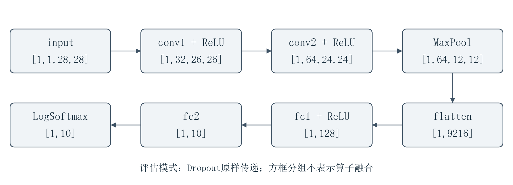
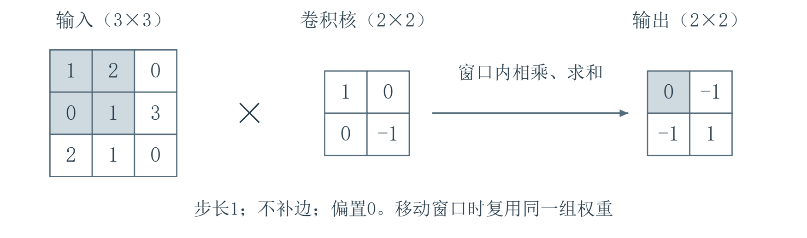
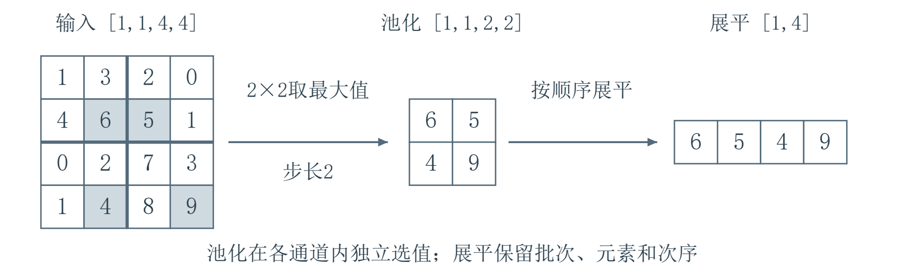
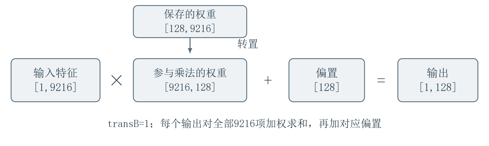
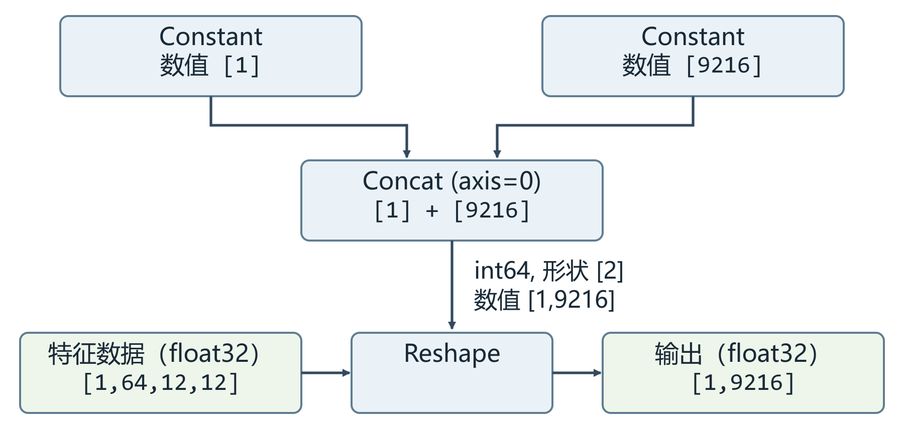
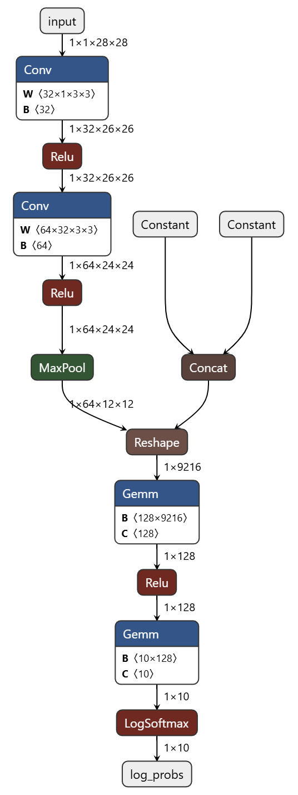

## 2.6 计算图、算子与模型结构

　　2.4节用MNIST模型识别了手写数字。一张28×28的灰度图已经整理成输入张量。模型接过这个张量后，要经过哪些计算，才能给出对应10个数字的结果？我们先沿着`Net.forward`的执行顺序追踪数据，再用已导出的ONNX计算图核对。2.5节介绍了ONNX格式，2.7节将沿用这套模型结构演示导出。

　　手写数字识别推动了早期卷积网络的发展。LeNet-5用卷积提取局部特征，再缩小特征图并完成分类[6]。本章选用PyTorch官方MNIST示例中的`Net`[3]。它用两层卷积和ReLU提取特征，用最大池化缩小特征图，最后用两层全连接完成分类。

　　本例用28×28灰度图作为输入，在CPU上就可以做推理对照。模型用到的算子较少，便于逐层查看形状和数值，再核对导出器与运行时的支持情况。设备上的速度与兼容性需按实际工具链验证。

### 2.6.1 从源码读计算图

　　卷积算出的张量会交给下一步激活。把每步计算画成节点，把张量从哪一步传到哪一步画成箭头，就得到计算图（computational graph）。顺着箭头可以追踪计算结果的去向，逆着箭头可以查找当前操作的输入。模型结构规定各步如何连接，权重和偏置提供计算所需的参数。中途得到的结果保存在中间张量中。

　　工程`src/main.py`中的`Net`定义了模型结构。`__init__`在创建模型时运行，其中的`self.conv1`等名称用来保存各层，供`forward`调用。`forward`则写明输入张量经过这些层的顺序。代码中的`nn`和`F`是导入时起的简称，分别提供网络层和激活、池化等函数。下面的代码先定义`Net`。按2.4节的方法加载权重并运行模型后，可以对照图 2-14 追踪各步的张量形状。

```python
import torch
import torch.nn as nn
import torch.nn.functional as F


class Net(nn.Module):
    def __init__(self):
        super(Net, self).__init__()
        self.conv1 = nn.Conv2d(1, 32, 3, 1)      # 1个输入通道，32个输出通道
        self.conv2 = nn.Conv2d(32, 64, 3, 1)
        self.dropout1 = nn.Dropout(0.25)
        self.dropout2 = nn.Dropout(0.5)
        self.fc1 = nn.Linear(9216, 128)
        self.fc2 = nn.Linear(128, 10)

    def forward(self, x):
        x = self.conv1(x)
        x = F.relu(x)
        x = self.conv2(x)
        x = F.relu(x)
        x = F.max_pool2d(x, 2)
        x = self.dropout1(x)
        x = torch.flatten(x, 1)                  # 保留批次维
        x = self.fc1(x)
        x = F.relu(x)
        x = self.dropout2(x)
        x = self.fc2(x)
        output = F.log_softmax(x, dim=1)
        return output
```

 <!-- -->

<p align="center">图 2-14 MNIST模型的计算主路径与输出形状</p>

　　`x`起初存放2.4节为一张图片准备的输入张量，形状为`[1,1,28,28]`。执行`x = self.conv1(x)`时，等号右边用当前的`x`做卷积，再把结果存回`x`。下一行`F.relu(x)`用的就是这个卷积结果。图 2-14 用箭头表示数据的去向，并把每层卷积和紧随其后的ReLU放在同一个方框里。

　　沿图看形状，第一维始终为1，表示一路都在处理同一张图片。第二维从输入的1变为32，再变为64，记录卷积产生的通道数。

### 2.6.2 数据、参数与属性

　　第一层卷积接收图片时，还要用到这一层的权重和偏置。这些参数来自训练后保存的模型。节点还保存步长、补边等设置，称为属性（attribute），用来规定窗口怎样移动、怎样处理边缘。读表 2-11 时，先看“对象”一列，分清本次输入、已保存的参数、节点设置和计算结果。

<p align="center">表 2-11 第一层卷积的数据、参数和属性</p>

| 对象 | 本模型中的内容 | 作用 |
| --- | --- | --- |
| 图片输入 | input：[1,1,28,28] | 当前要处理的数据 |
| 权重输入 | conv1.weight：[32,1,3,3] | 局部乘加使用的乘数 |
| 偏置输入 | conv1.bias：[32] | 每个输出通道额外加入的数 |
| 节点属性 | strides=[1,1]；pads=[0,0,0,0] | 步长为1，不补边 |
| 输出 | [1,32,26,26] | 一张图片对应32张26×26特征图 |

　　表中卷积的输出是32张26×26的数值网格。每张网格上的数仍按空间位置排列，称为特征图（feature map）。一个输出通道对应一张特征图，具体数值由权重和输入共同决定。仅凭通道编号，无法判断它对横线还是竖线响应更强。

　　在这份ONNX文件里，4份权重和4份偏置共8个参数张量已经保存好。图中这类预先存放的张量称为初始化张量（initializer），也可以用来保存其他常量。换一张图片时，模型继续使用原来的参数，重新计算特征图和最终输出。

### 2.6.3 算子与张量变换

　　图 2-14 中的两层卷积处理的是不同的张量，却都按卷积的规则计算。这类规则称为算子（operator），规定接收什么输入、怎样计算以及产生什么输出。同一种算子可以在多个节点使用。下面沿图中的顺序看各步操作。

**1. 卷积与激活**

　　卷积从图片的局部区域计算特征。图 2-15 中的窗口覆盖一小块输入，卷积核（kernel）为窗口内的各个位置提供权重。对应元素相乘，乘积求和后加上偏置，就得到输出中的一个数。窗口移到下一处时继续使用这组权重，这叫权重共享。这里卷积核保持原方向，采用互相关规则，神经网络中通常仍称为卷积。

 <!-- -->

<p align="center">图 2-15 卷积窗口移动与权重复用</p>

　　多通道卷积将各输入通道的局部乘加结果相加，最后加一次偏置。换一套核和偏置，就得到另一个输出通道。**输入通道参与求和，输出通道分别计算。**因此，第一层权重`[32,1,3,3]`表示32套核，每套覆盖1个输入通道。第二层`[64,32,3,3]`则有64套核，每套覆盖32个输入通道。

　　窗口每次移动的距离叫步长（stride），在输入边缘补上额外的行或列叫补边（padding）。本模型使用3×3核、步长1，不补边。因此，第一层将28×28缩到26×26，第二层再缩到24×24。每层卷积后，ReLU逐个处理特征值，张量形状保持不变。下面的式子给出输入一个数$x$时的ReLU结果。

$$
\operatorname{ReLU}(x)=\max(0,x)
\tag{2-15}
$$

**2. 池化与展平**

　　经过两层卷积后，每张图片对应64张24×24的特征图。最大池化（max pooling）在每个通道内，从一个局部窗口中只取最大的值，因此每张特征图的空间尺寸会缩小。池化窗口没有需要训练的权重。看图 2-16 的教学示例。左上角的2×2窗口只留下最大值6，排在池化结果的左上角。展平（flatten）再把池化留下的4个值按原顺序排成一行。

 <!-- -->

<p align="center">图 2-16 最大池化减少位置，展平合并维度</p>

　　池化使用2×2窗口、步长2，不补边。每张特征图从24×24缩为12×12，通道数仍为64。随后，`torch.flatten(x,1)`中的`x`是池化后的张量，`1`表示从第1轴开始合并，保留第0轴的批次。代码把每张图片的全部特征按原顺序排成一行，得到`[1,9216]`。下面计算每行有多少个值。

$$
F=64\times12\times12=9216
\tag{2-16}
$$

　　式中的$F$是每张图片展平后的特征数。这一行中的各个位置都对应后续全连接层的权重，因此展平时要保持原有顺序。

**3. 全连接与分类输出**

　　排成一行的9216项特征进入`fc1`。全连接层为每个输出使用一组权重，将全部输入与相应权重相乘、求和，再加偏置。`fc1`由此得到128项结果，`fc2`再把它们变成10个分类分数。

　　图 2-17 对照了`fc1`的输入与权重形状。ONNX用Gemm表示这次矩阵乘加，文件中的权重为`[128,9216]`。`transB=1`表示计算时交换这份权重的行和列，使乘法所需的9216个位置能够对应起来。

 <!-- -->

<p align="center">图 2-17 第一层全连接的矩阵乘加</p>

　　这10个分数依次对应数字0至9，称为原始分类分数，即logits。它们可以为负，总和也不要求为1。softmax把分数转换为总和为1的概率，LogSoftmax计算这些概率的自然对数。对数概率可以为负，各类别的大小顺序保持不变。

　　代码中的`dim=1`选中第1轴，也就是同一张图片的10个类别所在的轴。本次单张输入得到`[1,10]`的一行对数概率。调用程序在模型外用$\arg\max$找到最大值所在的列，再按列号读出预测数字。2.7节比较的是选出类别之前的整行对数概率。

**4. Constant、Concat与Reshape**

　　在源码里，展平只用了一行。图 2-18 中的Reshape接收两路输入。一路沿主路径传来图片特征，另一路给出要排成几行、每行几个值，也就是目标形状。

　　看形状支路，Constant直接输出节点属性中保存的常量张量。Concat按输入顺序沿`axis`指定的轴把张量接在一起，各元素的值保持原样。参加拼接的张量须具有相同的数据类型和轴数，拼接轴之外的轴长度也要一致。

 <!-- -->

<p align="center">图 2-18 Reshape的特征输入与形状输入</p>

　　两个Constant分别给出`[1]`和`[9216]`，Concat沿第0轴把它们拼成`[1,9216]`。这个张量存放的是两个整数，数据类型为int64。它自身的形状是`[2]`，里面的数值才是要交给Reshape的目标形状。

　　Reshape据此把另一路float32特征排成1行9216列，元素总数和顺序都保持原样。形状支路只提供尺寸，图片数据仍从原来的入口进入，也不需要新增训练参数。Constant通过节点输出常量，initializer则直接在模型文件中保存张量。

　　源码中的Dropout在训练时随机置零一部分数值，并缩放保留的值。评估时，Dropout直接传递输入，所以这份导出图省去了这些节点。Conv和Relu各自保留。

### 2.6.4 输入形状、布局与算子版本

　　表 2-12 把源码里的操作与ONNX中的节点对应起来。可以先看“源码操作”和“ONNX表达”两列，再沿“输出形状”一列追踪张量的变化。图 2-19 给出了这些节点的完整连接。

<p align="center">表 2-12 模型主要操作、参数与形状</p>

| 源码操作 | ONNX表达 | 参数形状或设置 | 输出形状 |
| --- | --- | --- | --- |
| 输入 | input | float32、NCHW | [1,1,28,28] |
| conv1、ReLU | Conv、Relu | 权重[32,1,3,3]，偏置[32] | [1,32,26,26] |
| conv2、ReLU | Conv、Relu | 权重[64,32,3,3]，偏置[64] | [1,64,24,24] |
| 最大池化 | MaxPool | 窗口2×2，步长2 | [1,64,12,12] |
| 展平 | Reshape及形状支路 | 目标形状[1,9216] | [1,9216] |
| fc1、ReLU | Gemm、Relu | 权重[128,9216]，偏置[128] | [1,128] |
| fc2 | Gemm | 权重[10,128]，偏置[10] | [1,10] |
| 对数概率 | LogSoftmax | 类别轴为1 | [1,10] |

　　图 2-19 所示模型的输入形状固定为`[1,1,28,28]`，这称为静态形状（static shape）。如果希望一次处理多张图片，可以让批次大小$N$在约束下变化，这样的轴称为动态维度（dynamic dimension）。图内的计算也要随之配合。比如，仅修改这份图的输入标签，展平目标仍是`[1,9216]`。若改变图片的高或宽，展平后的长度也可能与`fc1`所需的特征数不符。

　　NCHW按批次、通道、高、宽排列，NHWC按批次、高、宽、通道排列。换布局需要交换轴，Reshape改变形状时仍按原顺序读取元素。

　　算子集版本（opset）规定图中的算子按哪一版规则解释。图 2-19 所示的文件采用标准ONNX域的opset 20。2.7节另行导出的基线采用opset 17，只让批次维变化，仍接收按NCHW排列的28×28灰度图。

　　从图顶部的`input`出发，先沿着图片数据的路径往下看。到Reshape时，看看右侧形状支路从哪里接入，再沿Gemm走到末端的`log_probs`。Conv旁的W和B分别表示权重和偏置。Gemm旁的B和C表示矩阵乘加中的权重和偏置，要结合节点及张量形状辨认。

　　全图有13个计算节点，图输入、图输出和8个initializer不计入其中。在[Netron](https://netron.app/)中打开模型并选中节点，即可查看属性。数值一致性和设备兼容性还要分别检查。

 <!-- -->

<p align="center">图 2-19 原始MNIST模型的完整ONNX计算图</p>

图注：Netron 9.3.1。

### 2.6.5 按版本查阅算子定义

　　换一份模型时，可能会看到没见过的节点。先在节点记录中找算子类型`op_type`和所属域`domain`，再查看模型为这个域登记的opset。带着这三项信息去[ONNX官方算子索引](https://onnx.ai/onnx/operators/index.html)[14]查找。检索时用算子类型，节点名称可能由导出器另行生成。标准域在文件中可为空字符串，通常显示为`ai.onnx`。

　　找到算子后，选不高于模型opset的最新适用版本。先读Summary了解它做什么，再看Inputs和Attributes，分清哪些值沿连线传入，哪些设置写在节点里，并查看默认值。接着读Outputs和Type Constraints，核对输出形状和数据类型。

　　例如，图 2-19 采用opset 20。假如另一份opset 20的模型中出现ReduceMean，就应读它的18版定义。这一版把`axes`列为可选输入，13版则把它写成属性。`keepdims`决定求平均后是否保留相应的轴。查完定义，还要回到实际节点核对取值。遇到自定义域，查阅提供方的说明。部署前还需核对目标工具对实际算子、属性、类型和形状的支持。

　　2.7节将用同一套`Net`结构和配套权重另行导出模型。新文件的输出名为`output`，每张图片仍对应按数字0至9排列的10个对数概率。接着用同一批图片核对PyTorch和ONNX Runtime的完整输出，2.8节再把输入和输出约定整理成部署接口。
