# 第二章 神经网络基础与模型部署准备

第一章介绍了模型怎样与程序和设备共同完成任务。要进一步动手部署模型，还需要弄清模型接收什么数据、内部怎样计算，以及训练得到的参数怎样参与推理。本章从手写数字识别开始，在计算机上准备图像、建立网络并训练模型，再学习模型保存、导出与结果核对，为后续设备上的部署建立参考。

## 2.1 手写数字识别问题与数据集

### 2.1.1 从数字图像到分类问题

摄像头拍下纸上的一个手写数字后，识别程序可以尝试判断它所属的类别。人看到的是笔画组成的形状，程序接收的却是表示图像的一组数值。本章先处理已经整理好的单个数字图像，不讨论书写设备记录的笔迹轨迹，也暂不处理照片中的背景、数字定位和裁剪。这样可以先集中理解图像怎样进入模型，以及模型怎样给出分类结果。

一张数字图像由按行、列排列的小格组成，每个小格称为像素。灰度图用一个数表示每个像素的明暗。本章使用8位无符号整数保存原始灰度值：“位”是一个二进制位置，只能取0或1，8位共有 $2^8$ 种组合，因而可以表示从0到255的256个整数。0对应黑色，255对应白色，中间值表示不同灰度。

假设图像高、宽均为28像素，把各位置的数值按行、列排列为矩阵 $X$，则可写为：

$$
X\in\{0,1,\ldots,255\}^{28\times28}
\tag{2-1}
$$

式（2-1）中，$\in$ 表示“属于”，花括号列出允许的像素取值，右上角的 $28\times28$ 表示矩阵有28行、28列，并不是对像素值做乘方。每个元素对应一个像素。图像的已知正确类别称为**标签**，记为 $y$，取值为0—9中的一个整数。本章需要完成的是十分类：每张图像选择一个类别，不输出数字的位置，也不读出一整行号码。

原始图像还要经过输入处理，才能交给网络。用 $T$ 表示这一步处理，用 $f_{\theta}$ 表示参数为 $\theta$ 的模型，则一次计算可以写为：

$$
\boldsymbol{s}=f_{\theta}(T(X)),\qquad \boldsymbol{s}\in\mathbb{R}^{10}
\tag{2-2}
$$

式（2-2）中，$T(X)$ 表示输入处理后的图像数据；$\theta$ 表示模型中可通过训练调整的数值，权重和偏置是其中两类，具体作用在2.3节解释。$\boldsymbol{s}$ 是由十个数按顺序组成的输出向量，$\mathbb{R}^{10}$ 表示十个分量均为实数；实际程序用有限精度数值近似表示。分量索引从0开始，$s_k$ 表示索引为 $k$ 的输出，对应数字 $k$，其中 $k=0,\ldots,9$。本节先只要求这些输出可以用于比较类别，具体是原始分数、概率还是对数概率，将在2.3节结合网络定义说明。

程序从十个输出中选择最大值所在的类别，得到预测 $\hat y$：

$$
\hat y=\underset{k\in\{0,\ldots,9\}}{\arg\max}\;s_k
\tag{2-3}
$$

式（2-3）中的 $\arg\max$ 返回最大值所在的索引，不是最大值本身。例如，索引为3的分量（按日常次序数是第4项）最大，预测类别就是3。若存在相同最大值，还需按程序规定的规则选择；本章使用的接口在所比较轴上返回第一个最大值的位置。预测与标签是不同对象：$\hat y$ 是模型的回答，$y$ 是用于核对的参考答案。

这几个符号把任务分成了可以逐步学习的部分：2.1节观察 $X$ 与 $y$，2.2节建立输入处理 $T$，2.3节说明模型 $f_{\theta}$ 怎样计算，2.4节再学习怎样根据样本调整 $\theta$。本章在计算机上准备模型并建立参考，目标设备上的实际运行仍需后续验证。

> **插图编写提示：图 2-1（尚未绘制）——数字分类的计算与核对。** 使用一张真实MNIST图像，沿主线画出 $X\rightarrow T(X)\rightarrow f_{\theta}\rightarrow\boldsymbol{s}\rightarrow\hat y$；标签 $y$ 单独进入比较框，不连入推理模型。人为设定的十类输出注明“教学示意”。

### 2.1.2 从样本学习类别关系

为什么不直接把待识别图像与一张标准数字图逐像素比较？同一个人写两次数字，笔画位置和粗细也可能不同。同为数字3，两张图像中许多位置的灰度值可能不相等；数字3与8则可能只在少量关键笔画上存在区别。因此，像素是否相等不能直接作为类别是否相同的判断依据，整体像素差异也未必等同于类别差异。

把图像与预先保存的代表图像进行比较，称为模板比较，可以作为识别的起点。本章选择神经网络，是为了进一步学习一种能够根据样本调整参数的模型，并继续完成训练、导出和部署准备。模型接收许多图像及其标签，通过训练调整参数，使输出与类别之间建立联系。它是否学到了有用关系，不能只看训练图像上的结果。

如果程序记住了所有训练图像，却在新的写法上频繁出错，就没有达到识别任务的要求。利用已学关系处理新样本的能力称为**泛化能力**。因此需要保留未参与参数调整的数据，检查模型面对新输入时的表现；若还要据此选择模型配置，数据职责还应进一步区分，2.4节将给出具体划分。

新样本也有使用条件。本章数据是经过整理的单个数字。如果直接换成白底黑字、带阴影或数字偏在一角的照片，即使尺寸也是28×28，输入条件仍可能与训练数据不同。这类变化可能使识别效果下降。模型在一种数据条件下表现良好，不能直接推及任意拍摄场景。

> **插图编写提示：图 2-2（尚未绘制）——同类变化与类间相似。** 展示真实MNIST样本：一组不同写法的数字3，以及易混淆类别的代表样本。标明数据划分、原始索引和标签，用局部框指出笔画差异；不人为修改图像来制造证据。

### 2.1.3 MNIST数据集与样本观察

手写数字识别是文档自动处理中的一项典型任务，例如把纸面上的数字转成程序能够保存和使用的字符。为研究这类问题，研究者需要收集来自不同书写者的数字图像，并提供正确类别，供不同方法在共同的数据条件下训练和评价。MNIST便是在美国国家标准与技术研究院（National Institute of Standards and Technology，NIST）已有手写数字数据的基础上整理形成的，名称中的M来自Modified，表示经过修改整理的NIST数据。[1][6]

这种整理不只是把图像保存为同样大小。按照数据集说明，数字图像先保持原有宽高比例缩放，使其能够放入20×20像素的区域，再依据像素值分布确定的重心，在28×28画布中调整位置。这里的重心可以理解为把像素值作为权重得到的图像中心；这样的处理不意味着每张图的笔画外形完全一致。[1][6] 较统一的尺寸和位置，使读者能够先集中学习分类计算与训练流程，而不必同时解决真实照片中的数字定位和背景处理。它也说明，MNIST上的识别结果首先适用于相应的数据条件，不能直接代表任意拍摄图像上的效果。

本章使用MNIST手写数字数据集，数据集是按任务整理的一组样本及相关信息。每张图像宽、高均为28像素，只有一个灰度通道，标签为0—9。原训练部分包含60,000张图像，原测试部分包含10,000张图像。[1] 本章还将在原训练部分中划出验证样本，用于训练期间比较配置、选择模型；原测试部分用于模型选择完成后的评价。这里的“原训练部分”是数据集发布时的划分，与后文实际参与参数更新的训练集应加以区分。

MNIST采用暗背景、亮笔画的图像表示。笔画边缘可能包含多种灰度，不是只有黑、白两种数值。观察图像时，应同时留意类别、笔画与背景关系，而不只是确认窗口能否显示。

下面从导入所需工具开始读取数据。Torchvision提供MNIST数据集接口，Matplotlib用于显示图像。首次运行需要联网下载数据，文件保存到当前工作目录的`data`文件夹；已有完整数据时，可将`download`改为`False`。

```python
import matplotlib.pyplot as plt
from torchvision import datasets

train_raw = datasets.MNIST(root="data", train=True, download=True)
index = 7
image, label = train_raw[index]
print("图像尺寸：", image.size)
print("样本索引：", index, "标签：", label)
```

`train=True`选择原训练部分，未设置图像变换的对象记为`train_raw`。调用`train_raw[index]`返回一张图像对象及其整数标签。索引表示位置，不是类别；本例尺寸应为`(28, 28)`，索引7的标签为3。[2] 接着把读到的图像显示出来：

```python
plt.imshow(image, cmap="gray", vmin=0, vmax=255)
plt.title(f"index={index}, label={label}")
plt.axis("off")
plt.show()
```

`cmap="gray"`采用灰度显示，`vmin`和`vmax`固定明暗对应的数值范围，标题记录当前图像的索引与标签。运行后应把笔画、索引和标签对应起来。这里取得的是参考答案，尚未产生模型预测。

本章正文代码按操作过程分段给出，在同一程序或交互会话中顺序执行，后面的代码沿用前面创建的对象。基础实验可以在CPU上完成；环境安装、完整运行入口与辅助功能见线上项目。读者也可以将正文各段按顺序合并运行，不必借助线上项目补齐未定义的变量。

> **线上项目2-A：观察MNIST样本。** 包含完整的数据读取与显示代码、指定索引查询、多类别样本网格及同类不同写法对照。运行后保存样本索引、标签和观察图。配套文件见配套资料索引（待补）；书籍网站发布入口待确定。项目中不调用识别模型。

图像可以显示，只说明观察环节已经完成。模型仍需要具有明确轴含义、数据类型和数值处理规则的输入，下一节将建立这些规则。

## 2.2 图像数据与张量表示

一张图像既可以显示为笔画，也可以表示为数组。模型计算依赖数组中的数值及其位置关系，因此输入准备不能只追求“得到正确形状”。本节先说明数据怎样组织，再解释数值怎样变换，最后检查这些处理是否符合模型要求。

### 2.2.1 像素数组、张量与索引

对本章的8位灰度图，像素值为0—255的整数，0对应黑色，255对应白色。把数值按行、列排列，得到形状为`(28, 28)`的二维数组。以 $X_{h,w}$ 表示第 $h$ 行、第 $w$ 列的像素，其中 $h$ 表示行索引，$w$ 表示列索引，均取0—27，因此第14行、第14列对应 $X_{13,13}$。

在程序中，具有多维结构的数值可组织为**张量**。单个数可视为零维张量，一组沿一个方向排列的数构成一维张量，矩阵则有行、列两个方向。描述张量时，将这些可以分别索引的方向称为**轴**。应区分轴数、各轴长度和元素总数：形状`(28, 28)`有两个轴，每轴长度为28，共有784个元素。后文尽量用“轴数”和“轴长度”说明结构，避免把不同意义都简称为维度。

接着导入NumPy和PyTorch，将上一节的`image`转为像素数组，再建立二维张量。

```python
import numpy as np
import torch

pixels = np.array(image.convert("L"), dtype=np.uint8, copy=True)
gray = torch.from_numpy(pixels)
print("形状和类型：", gray.shape, gray.dtype)
value = gray[13, 13].item()
print("位置(13,13)的像素值：", value)
print("附近的像素：", gray[12:15, 12:15])
```

`convert("L")`将图像表示为8位灰度，`from_numpy`根据数组建立张量。形状应为`[28, 28]`，类型为`torch.uint8`。`item()`将单个元素取为Python数值；切片`12:15`选择索引12、13、14，从而显示一个3×3局部。这一步返回的像素值它应与图像相应位置的明暗相符，但不能用单个位置判断整张图像的值域。还可以观察局部区域，将数值网格与笔画边缘对应起来。

> **插图编写提示：图 2-3（尚未绘制）——图像与像素索引。** 左侧为真实完整样本，中间框选笔画和背景交界的局部，右侧列出同一区域的真实像素值；标明从0开始的行列索引。不得用随机矩阵代替该图像的像素。

### 2.2.2 通道、批次与输入形状

灰度图每个位置只有一个明暗分量；RGB分别取英文Red、Green、Blue的首字母，表示红、绿、蓝三个分量，每个分量称为一个**通道**。本章网络采用通道、高、宽的单图组织方式，简称CHW，其中C、H、W分别来自Channel、Height、Width，表示通道数、高和宽。灰度图虽然只有一个通道，也要明确表示通道轴。

上一小节的`gray`形状为`[28, 28]`。先增加通道轴，观察形状与元素数量：

```python
single_u8 = gray.unsqueeze(0)
print("增加通道轴前：", gray.shape, gray.numel())
print("增加通道轴后：", single_u8.shape, single_u8.numel())
```

`unsqueeze(0)`在第0轴位置增加长度为1的轴，结果为`[1, 28, 28]`。`numel()`返回元素总数，操作前后均为784，说明这里没有增加像素或样本。现在再读取两张图像，采用相同的灰度表示，并与标签一起组织：

```python
indices = [7, 10]
images = [train_raw[i][0] for i in indices]
singles_u8 = []
for sample in images:
    array = np.array(sample.convert("L"), dtype=np.uint8, copy=True)
    singles_u8.append(torch.from_numpy(array).unsqueeze(0))

batch_u8 = torch.stack(singles_u8, dim=0)
labels = torch.tensor([train_raw[i][1] for i in indices], dtype=torch.int64)
print("图像批次：", batch_u8.shape, batch_u8.dtype)
print("对应标签：", labels.shape, labels.tolist())
```

`stack`沿新轴组织两张图像，得到`[2, 1, 28, 28]`，四个轴按样本、通道、高、宽排列，称为NCHW，其中N表示批次中的样本数。标签形状为`[2]`，按`indices`的相同顺序保存；`int64`是64位整数类型，本章用它保存类别标签。这里还只是uint8图像批次，未完成后面的数值处理，不能直接当作本章网络的浮点输入。

对批量输入，用 $x_{n,c,h,w}$ 表示样本索引 $n$、通道索引 $c$、行列索引 $(h,w)$ 对应的值；所有索引从0开始，$n$ 取0到 $N-1$，本章单通道输入的 $c$ 只能取0。本章采用浮点计算时，输入写为：

$$
\boldsymbol{x}\in\mathbb{R}^{N\times1\times28\times28}
\tag{2-4}
$$

这里 $N$ 是本次实际图像数。`[64,1,28,28]`表示64张单通道图像，而不是一张具有64个通道的图像。标签另用长度为 $N$ 的数组保存，第 $n$ 个标签对应第 $n$ 张图像。模型对批次中的图像使用同一套参数，但每张图像仍有自己的输出。

> **插图编写提示：图 2-4（尚未绘制）——从单图到批次。** 依次展示HW、CHW与两张图像组成的NCHW，明确标注每个轴；在批次旁将两个标签分别连到对应样本。只表示轴组织，不暗示已完成数值变换。

### 2.2.3 数据类型、范围缩放与标准化

形状确定了数值的位置，**数据类型**则规定数值怎样表示。`uint8`使用8位表示0—255的整数，每个元素占1字节（Byte），1字节等于8位；`float32`每个元素占4字节，可表示带小数及不同尺度的数值，但精度有限。将128改存为128.0，只改变表示类型，没有把像素范围缩小。

本章先把像素转为float32，再除以原始灰度最大值255。若原像素为 $p$，缩放结果记为 $u$，则：

$$
u=\frac{p}{255}
\tag{2-5}
$$

原来的0—255对应0—1。随后采用固定均值 $\mu$ 和标准差 $\sigma$ 进行标准化。均值表示所统计数值的平均水平，标准差表示这些数值围绕均值的离散程度；标准差越大，说明整体偏离均值的程度越大。处理规则为：

$$
x=\frac{u-\mu}{\sigma}=\frac{p/255-\mu}{\sigma}
\tag{2-6}
$$

式（2-6）中，减均值使数值中心平移，除标准差调整尺度。它并不增加图像信息，而是改变模型接收的数值表示。先对上一小节的图像批次执行类型转换和范围缩放：

```python
batch_f32 = batch_u8.to(torch.float32)
scaled = batch_f32 / 255.0
print("类型转换后：", batch_f32.dtype)
print("缩放后形状：", scaled.shape)
print("实际值域：", scaled.min().item(), scaled.max().item())
```

`batch_f32`和`scaled`的形状均保持`[2, 1, 28, 28]`。前者只是将像素改用浮点数表示，后者才把范围缩小到0—1；实际最小值和最大值应落在这个区间内。本章随后沿用MNIST示例中的固定均值0.1307和标准差0.3081。[3]

```python
mean, std = 0.1307, 0.3081
batch = (scaled - mean) / std
print("模型输入：", batch.shape, batch.dtype)
print("标准化后值域：", batch.min().item(), batch.max().item())

probe = torch.tensor([0.0, 128.0, 255.0])
print("代表性像素处理后：", (probe / 255.0 - mean) / std)
```

`mean`和`std`分别对应式（2-6）的 $\mu$、$\sigma$。`probe`是用于验算的三个教学像素值，不是对图像内容的替换。原像素0约变为−0.4242，255约变为2.8215，说明标准化后的值不再局限于0—1。`batch`现在表示已完成数值处理的两张图像，后面的网络计算将使用它。

各步骤明确后，可以整理为处理单张图像的函数，避免训练和推理各写一套规则：

```python
def prepare_image(pil_image):
    array = np.array(pil_image.convert("L"), dtype=np.uint8, copy=True)
    if array.shape != (28, 28):
        raise ValueError("本例要求28×28灰度图")
    pixels = torch.from_numpy(array).unsqueeze(0)
    x = pixels.to(torch.float32) / 255.0
    x = (x - mean) / std
    return x

batch_from_function = torch.stack([prepare_image(sample) for sample in images])
print("与分步处理一致：", torch.equal(batch, batch_from_function))
```

函数沿用前面固定的`mean`和`std`，输入为一张图像，返回`[1, 28, 28]`浮点张量。尺寸检查中的`raise ValueError`在条件不符时停止并给出提示，不会悄悄改变图像。`torch.equal`检查形状和数值是否相同，此处预期为`True`。线上项目采用相同处理规则，后续可直接复用该函数。

如果需要从自己的数据确定参数，可以在训练数据的缩放像素上统计。设统计范围内共有 $M$ 个值 $u_i$，以参与统计的全部像素为总体，均值和标准差分别为：

$$
\mu=\frac{1}{M}\sum_{i=1}^{M}u_i
\tag{2-7}
$$

$$
\sigma=\sqrt{\frac{1}{M}\sum_{i=1}^{M}(u_i-\mu)^2}
\tag{2-8}
$$

式（2-7）和式（2-8）中的 $i$ 从1开始，是统计求和所用的编号，不是图像坐标；$M$ 为参与统计的像素总数。这里统计的是训练数据中的像素，不是针对每张待识别图像重新计算。参数确定后，要固定用于验证、测试和推理；不能利用测试数据反过来决定训练预处理。彩色数据还需要说明是逐通道统计还是采用其他约定。本章沿用的常数不冒充按后续新划分重新统计的结果。

使用全体训练像素得到的参数，并不意味着每张图像处理后各自都恰好均值为0、标准差为1。标准化也不能脱离任务保证提高准确率。其效果需要实验评价，但一旦训练采用了这项约定，后续使用模型就必须保持一致。实际估计时还应检查标准差是否为0，避免无定义的除法。

范围相同也不能证明语义相同。例如，将图像黑白反转后再标准化，可能仍具有相同的最小值和最大值，但笔画与背景已交换。数值检查需要与原始图像和处理顺序共同核对。

> **线上项目2-B：构造并核验模型输入。** 完整代码统一使用`prepare_image()`执行灰度表示、尺寸检查、缩放和标准化，再构造单图及批量输入；另提供像素变换与容量核对。见配套资料索引（待补）。
>
> **线上拓展阅读2-R1：标准化参数怎样确定。** 建议阅读路径为“固定参数与逐图处理的区别—训练数据统计—统计约定与复现”。本稿已给出核心原理；统计演示代码和读物编写范围见资料索引，正式网站文章待发布。

### 2.2.4 轴置换与形状重组

图像数组还可能把通道放在最后，形成HWC。如果模型要求CHW，需要交换轴的对应顺序。下面只用一行两个彩色像素说明规则：第一个像素为10、20、30，第二个为40、50、60。这是教学数组，即使转成CHW仍有三个通道，不能直接送入本章要求单通道的网络。

```python
hwc = torch.tensor([[[10, 20, 30], [40, 50, 60]]])
chw = hwc.permute(2, 0, 1)
reshaped = hwc.reshape(3, 1, 2)
print("轴置换：", chw.shape, chw.tolist())
print("形状重组：", reshaped.shape, reshaped.tolist())
```

轴置换后，三个通道分别为`[[10,40]]`、`[[20,50]]`、`[[30,60]]`；直接重塑形状则为`[[10,20]]`、`[[30,40]]`、`[[50,60]]`。两种结果形状都为`[3,1,2]`，元素总数相同，像素与通道的对应关系却不同。

正确的轴交换满足：

$$
\mathrm{CHW}[c,h,w]=\mathrm{HWC}[h,w,c]
\tag{2-9}
$$

式（2-9）规定的是新旧索引处数值相等，CHW和HWC在这里分别表示转换后的张量和转换前的数组。重塑形状按既定元素次序重新组织各轴，不会根据“高、宽、通道”的含义自动寻找对应位置；轴置换则明确规定新旧轴的关系。这里讨论逻辑上的元素对应，不据此判断底层是否复制数据。RGB与BGR分别按红绿蓝和蓝绿红排列，是另外一项通道语义约定，也不能仅凭形状推断。

<p align="center">表 2-1 轴置换与形状重组的比较</p>

| 操作 | 主要改变 | 是否增加样本 | 元素总数 |
| --- | --- | --- | --- |
| 增加长度为1的轴 | 表示结构 | 否 | 不变 |
| 堆叠多张图像 | 批次组织 | 是 | 随图像数增加 |
| 轴置换 | 轴的对应次序 | 否 | 不变 |
| 重塑形状 | 维度分组方式 | 否 | 不变 |
| 类型转换 | 数值表示类型 | 否 | 不变 |

> **插图编写提示：图 2-5（尚未绘制）——相同形状下的不同对应关系。** 使用正文六个数，以通道颜色追踪permute和reshape两条支路，展示两组实际结果；不要画成物理内存搬运图。
>
> **线上拓展阅读2-R2：轴变换、视图与连续存储。** 正文要求掌握索引对应；视图、步幅、共享存储及`contiguous()`作为进一步阅读，不作为完成当前实验的前提。编写范围见配套资料索引（待补），正式文章待发布。

### 2.2.5 数据容量与输入核验

第一章指出模型文件大小不能代替运行内存需求，现在可以计算其中一部分——输入张量有效元素的逻辑容量。设输入形状为 $[N,C,H,W]$，其中 $N$ 为样本数、$C$ 为通道数、$H$ 为高、$W$ 为宽，每个元素占 $b$ 字节，则有效元素的逻辑容量 $B$ 为：

$$
B=NCHWb
\tag{2-10}
$$

式（2-10）中的 $B$ 以字节为单位，不包括对象管理信息、额外副本或运行软件空间。一张uint8灰度图含28×28个元素，共784 Byte；相同数据改用float32后为3,136 Byte。64张float32图像的输入为200,704 Byte，即196 KiB；KiB是二进制容量单位，1 KiB等于1,024 Byte。增加长度为1的轴不改变元素总数；其他条件固定时，批次翻倍容量翻倍，高宽同时翻倍则容量增至四倍。

对本节已经准备好的`batch`，先读出形状、类型及元素数量，再计算容量：

```python
elements = batch.numel()
element_bytes = batch.element_size()
logical_bytes = elements * element_bytes
print("形状与类型：", batch.shape, batch.dtype)
print("元素数与每元素字节数：", elements, element_bytes)
print("逻辑容量：", logical_bytes, "Byte")
```

两张图像共有1,568个元素，每个float32元素占4字节，逻辑容量应为6,272 Byte，可按式（2-10）独立验算。

有效元素容量不能直接等同于实际分配或进程内存峰值。网络参数、中间结果及运行软件还有其他开销；本节先把输入容量这一项算清楚。

输入核验还要区分结构和语义。轴数、固定尺寸、数据类型（程序中常以`dtype`表示）、数值是否有限以及标签数量可以由程序检查。有限值检查用于排除NaN（无效数值）和Inf（无穷大）等异常结果；颜色含义、标准化规则和样本顺序则需要结合来源与处理过程核对。两组形状都为`[N,1,28,28]`的float32数据，一组可能为0—1像素，另一组可能已标准化，不能互换。

在把`batch`交给下一节网络前，可以将已经明确的要求写成检查条件：

```python
assert batch.ndim == 4
assert tuple(batch.shape[1:]) == (1, 28, 28)
assert batch.dtype == torch.float32
assert torch.isfinite(batch).all().item()
assert labels.shape == (batch.shape[0],)
assert labels.dtype == torch.int64
assert ((labels >= 0) & (labels <= 9)).all().item()
print("输入结构检查通过")
```

`assert`要求条件成立，否则停止并报告断言错误。`ndim`返回轴数，`shape[1:]`取得除批次轴外的形状，`isfinite`逐元素检查是否为有限值；`all()`要求全部元素满足条件。这些检查覆盖结构、数值有效性和标签范围，但不会自动识别黑白反转或标准化参数用错。

线上项目2-B逐项执行这些检查，并保存原图、处理规则及代表性结果。检查通过表示已满足所检查的条件，不是自动证明所有输入语义正确。到这里，读者应能够解释输入张量每个轴和每个数的含义；下一节将在这份输入上建立网络，观察一次完整前向计算。

## 2.3 神经网络怎样完成分类

输入张量保存了像素，但其中还没有直接写着“数字3”。模型需要通过一系列计算，把像素之间的关系转成类别判断。本节先把网络参数看作已经给定，说明一次输入怎样经过网络。参数怎样从样本中学到，将在2.4节讨论。

### 2.3.1 从加权计算到网络参数

一种基本计算方式是给不同输入分配不同权重，再把结果相加并加上偏置。设输入为两个数 $x_1$、$x_2$，计算可以写成：

$$
z=w_1x_1+w_2x_2+b
\tag{2-11}
$$

其中 $w_1$、$w_2$ 是权重，$b$ 是偏置。例如，输入为2和3，权重分别为0.5和−1，偏置为1，便得到 $z=-1$。换一组权重或偏置，即使输入不变，输出也可能改变。训练就是依据数据调整网络中这些可以学习的数值。

加权求和后还可以接一个激活函数。本章采用的ReLU将负数置为0，非负数保持不变，其计算规则为：

$$
\operatorname{ReLU}(z)=\max(0,z)
\tag{2-12}
$$

上例的−1经过ReLU变成0；如果加权计算得到的结果为3，经过ReLU后仍为3。

如果中间始终只做线性计算，多层组合仍可归结为一次线性计算。加入非线性变换，才能扩大网络可以表达的关系。ReLU就是本章采用的一种非线性变换。

在图像分类中，网络会执行许多这样的计算，并把前面得到的结果交给后面使用。从图像输入到最终输出的这一过程称为**前向计算**。输入图像变化时，结果会变化；在使用固定模型推理时，权重和偏置保持不变。

### 2.3.2 卷积怎样处理局部图像

数字的笔画由相邻像素共同形成。观察一个局部区域，比只看某个像素更容易发现短线、转折等变化。卷积层利用局部窗口处理图像，并在不同位置复用同一组权重。这组权重称为**卷积核**。

先看一个只用于说明计算的小例子。假设图像窗口为`[[1,2],[3,4]]`，卷积核为`[[1,0],[0,-1]]`，偏置为1。将对应位置相乘后求和，再加偏置，得到 $1\times1+2\times0+3\times0+4\times(-1)+1=-2$。窗口移到下一个位置后，仍使用这组权重继续计算。各位置的结果按空间位置排列，形成一张**特征图**。

这里卷积核按原顺序与窗口相乘，不进行旋转；严格说采用的是互相关计算规则，神经网络中通常仍称为卷积。[4] 权重在各位置复用，称为权重共享。它使网络能够用同一种局部计算观察图像不同位置，而不必为每个位置单独设置一整套权重。

窗口每次移动的距离叫**步长**，在图像边缘补充位置叫**填充**。本章第一层使用3×3卷积核、步长1、不填充。沿28个位置放置长度为3的窗口，共有26个有效起点，因此输出高、宽均为26。第二层以26×26为输入，采用相同窗口和移动方式，输出变为24×24。

一张图像可以产生多个输出通道。第一层输入只有一个灰度通道，使用32套不同的卷积核与偏置，得到32个通道的特征图。对一张图像而言，输出形状为`[32, 26, 26]`；带上批次轴，则为`[N, 32, 26, 26]`。这里32表示输出通道数，不是图像张数。

第二层接收32个通道。为了得到一个输出通道，它需要在各输入通道的局部窗口上分别乘加，把结果汇总后再加一次偏置。第二层共有64套这样的计算，产生64个输出通道。因此权重形状为`[64, 32, 3, 3]`：64套输出核，每套覆盖32个输入通道，每个通道对应3×3权重。

不同通道使用不同参数，有机会学习不同的局部响应，但不能在训练前就把某一通道认定为固定的“横线检测器”或“数字3检测器”。它实际响应什么，需要结合训练后的参数与样本观察。

> **插图编写提示：图 2-6（建议插图，尚未绘制）：卷积的局部计算与滑动。用带坐标的小型二维输入、固定卷积核和输出网格，突出第一个窗口的逐项乘加与偏置，再用虚线显示窗口右移后使用同一组权重。建议改用3×3核与项目一致；若保留正文2×2核，注明仅为局部运算示例。另设小面板说明两个输入通道分别计算、相加并加一次偏置得到一个输出通道，避免画成一个输入通道只对应一个输出通道。**

### 2.3.3 激活与最大池化

本章在两层卷积后分别使用ReLU。它逐个处理特征值，将负数变为0，不改变轴数或各轴长度。例如，卷积输出`[N, 64, 24, 24]`经过ReLU后仍为相同形状，但其中部分数值已经改变。

接下来使用**最大池化**缩小空间尺寸。它在每个通道内部按窗口选择最大值，不把不同通道混在一起。例如，窗口`[[1,3],[2,0]]`的最大值为3。若采用2×2窗口、步长2且不填充，24×24的每个通道就变成12×12，64个通道仍保留，因此结果为`[N, 64, 12, 12]`。

池化没有需要学习的窗口权重。它减少空间位置，保留窗口中较强的响应，同时也丢失其他值及部分精确位置信息。因此不能把池化理解为“只去掉无用信息”，也不能据此保证任意位置变化都不会影响分类结果。

卷积、ReLU和池化承担不同职责：卷积用参数组合局部输入，ReLU改变数值关系，池化按窗口选择并减少空间位置。判断这一段结构是否接对，可以沿输入检查每一步形状，并用小矩阵核对局部计算，而不是只看最终程序有没有报错。

> **插图编写提示：图 2-7（建议插图，尚未绘制）：ReLU与最大池化的数值变化。左侧用含正负数的小矩阵展示ReLU，强调形状不变；右侧用4×4矩阵分成四个2×2窗口，标出各最大值并得到2×2输出，注明步长2。两个面板分别说明操作，不暗示池化必须接在图示矩阵的ReLU结果后。**

### 2.3.4 展平、全连接与类别输出

经过池化后，每张图像对应64个12×12特征图。为了把这些特征交给后面的全连接层，先把每张图像的特征按既定顺序排列成一个向量，称为**展平**，再沿批次轴组织这些向量。每张图像共有 $64\times12\times12=9216$ 个特征值，所以`[N, 64, 12, 12]`变为`[N, 9216]`。

展平只改变组织方式，不像池化那样选择或丢弃元素。批次轴必须保留，否则会把不同图像的特征混成一个样本。代码`torch.flatten(x, 1)`中的1表示从第1轴开始合并后面的轴，第0轴仍用于区分样本。

**全连接层**让每个输出与全部输入特征建立加权联系。第一层将9,216个特征组合成128个中间特征，随后使用ReLU；第二层再把128个特征变为10个类别分数。这里128表示中间特征数，与批次大小无关。

这十个原始分数常称为logits。它们可以为负，也不要求总和为1。要形成预测类别，可以直接选择其中最大值所在的位置。实际程序用`argmax`完成这种选择；输出有多张图像时，应在每张图像自己的十个类别之间比较。

如果还需要用概率形式表示模型对各类的倾向，可以使用Softmax，将十个分数转换为总和为1的一组类别概率。本章模型采用LogSoftmax，返回对应概率的自然对数，称为对数概率，便于与后续损失函数配合。[5] 这里应先记住模型最终返回的是对数概率，而不是前一层的原始分数。

用一组人为设定的数值观察两种表示。假设数字3的概率为0.70，其余九类每类均为 $1/30$，合计0.30，对应关系如下。

<p align="center">表 2-2 分类概率及其自然对数示例</p>

| 类别 | 教学概率 | 对应的自然对数（约值） |
| --- | ---: | ---: |
| 数字3 | 0.70 | −0.3567 |
| 其余九类中的每一类 | $1/30$ | −3.4012 |

表中数值仅为教学示意，不是本章模型的实测输出。0.70大于 $1/30$，其对数−0.3567也大于−3.4012。因此，无论比较概率还是对数概率，最大值都对应数字3。取对数保持了类别间的大小顺序；需要查看概率时，可以对模型输出取指数。

输出中的第0列至第9列依次对应数字0—9，这是本章的类别约定。换成其他任务时，列号需要通过相应类别表解释。即使某类概率很高，也不保证预测一定正确，仍需与同一图像的标签比较，并在更多样本上评价。

> **插图编写提示：图 2-8（建议插图，尚未绘制）：展平、全连接与类别选择。上部用两个2×2教学特征图说明按确定顺序展平成长度为8的向量、保留样本边界；下部用少量节点说明全连接，再列出十类输出与argmax。真实网络的9216→128→10另行标注，简化节点不冒充实际节点数。若展示概率或对数概率，明确其类型并保持数值对应。**

### 2.3.5 完整网络与一次前向计算

把前面的计算连接起来，就得到本章使用的卷积神经网络。下面沿用原MNIST项目的主要结构。[3]

代码中的`Net`表示一种网络结构，`Net()`创建一个具体模型。`nn.Module`是PyTorch组织网络的基础类；`super().__init__()`先完成基础初始化，随后将各层保存在模型对象中。`__init__`创建需要使用的层，调用模型时则按`forward`规定的顺序计算。初次阅读时，可以先将注意力放在各层定义及其调用顺序上。

卷积和全连接层包含可学习参数；ReLU、池化和展平也参与计算，但不因此增加可学习参数。

```python
from torch import nn
import torch.nn.functional as F

class Net(nn.Module):
    def __init__(self):
        super().__init__()
        self.conv1 = nn.Conv2d(1, 32, kernel_size=3, stride=1)
        self.conv2 = nn.Conv2d(32, 64, kernel_size=3, stride=1)
        self.dropout1 = nn.Dropout(0.25)
        self.fc1 = nn.Linear(9216, 128)
        self.dropout2 = nn.Dropout(0.5)
        self.fc2 = nn.Linear(128, 10)

    def forward(self, x):
        x = F.relu(self.conv1(x))
        x = F.relu(self.conv2(x))
        x = F.max_pool2d(x, kernel_size=2)
        x = self.dropout1(x)
        x = torch.flatten(x, 1)
        x = F.relu(self.fc1(x))
        x = self.dropout2(x)
        x = self.fc2(x)
        return F.log_softmax(x, dim=1)
```

网络还包含两处Dropout。训练时，它们随机将部分值置零，并按约定缩放保留值；评估时原样传递输入。它们不改变张量形状，也没有可学习参数。这里先保留其在结构中的位置，作用与训练设置将在2.4节说明。

<p align="center">表 2-3 本章网络的主要形状变化与参数量</p>

| 计算位置 | 输出形状 | 本层可学习参数量 |
| --- | --- | ---: |
| 输入 | `[N, 1, 28, 28]` | — |
| 第一层卷积与ReLU | `[N, 32, 26, 26]` | 320 |
| 第二层卷积与ReLU | `[N, 64, 24, 24]` | 18,496 |
| 最大池化 | `[N, 64, 12, 12]` | 0 |
| 展平 | `[N, 9216]` | 0 |
| 第一层全连接与ReLU | `[N, 128]` | 1,179,776 |
| 第二层全连接 | `[N, 10]` | 1,290 |
| LogSoftmax | `[N, 10]` | 0 |

表中参数量包含偏置，两处Dropout未单独列出，因为它们不改变形状且参数量为0。第一层卷积的参数为 $32\times1\times3\times3$ 个权重加32个偏置，共320个；第一层全连接的参数为 $9216\times128$ 个权重加128个偏置，共1,179,776个。整个网络共有1,199,882个可学习参数，大部分位于第一层全连接。

这些参数若全部以float32保存，仅数值的逻辑容量约为4.58 MiB；它不是模型文件大小，也不是运行内存峰值。本章选择这一结构，是为了学习输入、网络、训练与模型导出的关系，不据此认定它是目标设备上的最优结构。

> **插图编写提示：图 2-9（建议插图，尚未绘制）：本章网络的完整前向路径。依次为输入、Conv1/ReLU、Conv2/ReLU、MaxPool、Dropout、Flatten、Linear/ReLU、Dropout、Linear、LogSoftmax；标注各阶段形状，与表 2-3 逐项对应。注明N为样本数、图示对应评估模式；不使用未经训练的彩色特征图作为已学习特征的证据。**

现在可以把2.2节构造的两张图像送入网络，检查一次完整前向计算。按顺序执行2.1—2.2的正文代码后，`batch`和`labels`分别表示两张图像的输入及标签，可以接着执行本节网络定义和以下代码。也可以运行线上项目2-B并保留交互环境，再继续本节操作。完整运行入口见配套资料索引（待补）。

```python
model = Net()
model.eval()
with torch.no_grad():
    log_probs = model(batch)

predictions = log_probs.argmax(dim=1)
print("输出形状：", log_probs.shape)
print("预测类别：", predictions.tolist())
print("真实标签：", labels.tolist())
print("参数数量：", sum(p.numel() for p in model.parameters()))
```

`eval()`使Dropout采用评估行为，`no_grad()`关闭本次计算的梯度记录，两者的区别将在训练与评价中进一步说明。本例的输出形状应为`[2, 10]`，表示两张图像各有十个类别的对数概率，参数数量应与表中总量一致。

这里刚创建的模型尚未训练，参数只是初始化值。因此预测类别没有固定的正确答案，偶然与标签相同也不能证明模型已经学会识别。本次检查回答的是：输入能否沿既定结构完成计算，输出形状与参数数量是否符合设计。它没有回答识别效果是否达到要求。

在单张图像的前向计算中，批次轴始终用于区分图像，通道与空间轴逐步变成用于分类的特征，最终每张图像得到十个输出。下一节将利用样本和标签计算损失，通过反向传播与优化器调整参数，再使用独立数据检查学习效果。

## 2.4 模型训练、保存与推理

### 2.4.1 划分数据并组织批次

2.3节用刚初始化的网络检查了前向计算。接下来沿用同一个 `Net` 定义和2.2节的 `prepare_image()`，让模型根据图像和标签调整参数。

训练集用于更新参数，验证集用于比较训练过程中得到的候选权重，测试集用于模型选定后的评价。这里从MNIST原训练部分随机划出5,000张作为验证集，其余55,000张用于训练，原测试部分的10,000张保留用于最终评价。这个划分用于下面的教学示例。后文所引的实验结果各自沿用原记录中的权重和评价条件。

```python
from torch.utils.data import DataLoader, random_split

split_seed = 42
torch.manual_seed(split_seed)
train_all = datasets.MNIST(
    root="data", train=True, download=True, transform=prepare_image
)
test_data = datasets.MNIST(
    root="data", train=False, download=True, transform=prepare_image
)
train_data, val_data = random_split(
    train_all, [55_000, 5_000],
    generator=torch.Generator().manual_seed(split_seed),
)
train_loader = DataLoader(train_data, batch_size=64, shuffle=True)
val_loader = DataLoader(val_data, batch_size=1000, shuffle=False)
test_loader = DataLoader(test_data, batch_size=1000, shuffle=False)
```

固定划分种子便于重复取得同一组训练和验证索引。数据加载器把样本组织成批次。对含有 $N$ 张图片的批次，图像张量形状为 `[N, 1, 28, 28]`，标签形状为 `[N]`。训练时打乱样本次序，每张图像及其标签仍成对移动。

### 2.4.2 计算损失并更新参数

模型每次前向计算返回十个对数概率。负对数似然损失（negative log-likelihood loss，NLL）取出真实类别对应的对数概率并取负值。若一个批次有 $N$ 张图像，$p_{i,y_i}$ 表示模型分给第 $i$ 张图像真实类别 $y_i$ 的概率，则批次平均损失为

$$
L=-\frac{1}{N}\sum_{i=1}^{N}\log p_{i,y_i}
\tag{2-13}
$$

真实类别的概率越大，该样本对损失的贡献越小。准确率只检查最大分数是否对应真实类别，损失还反映模型给真实类别分配了多少概率。本章的 `Net` 已经返回对数概率，所以直接交给 `F.nll_loss`。

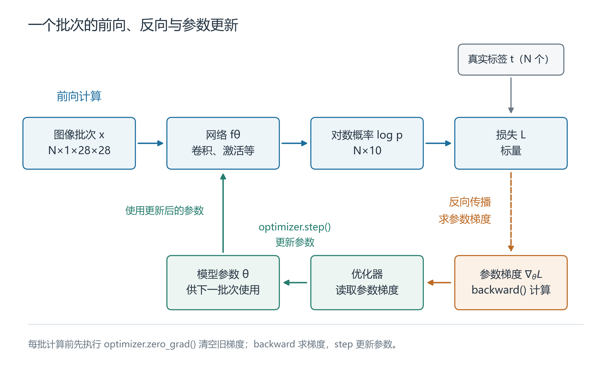 <!-- -->

<p align="center">图 2-10 一个批次的计算与参数更新</p>

图注：图中的 $t$ 表示整批真实标签。蓝色为前向计算，橙色为梯度计算，绿色为参数更新和后续使用。

下面沿用MNIST示例中的Adadelta优化器和StepLR调度方式[3]，在CPU上运行。一次迭代先清除上一批次留下的梯度，再前向计算损失、反向传播求梯度，最后由优化器更新参数。学习率调度放在外层轮次循环中。

```python
model = Net()
optimizer = torch.optim.Adadelta(model.parameters(), lr=1.0)
scheduler = torch.optim.lr_scheduler.StepLR(optimizer, step_size=1, gamma=0.7)

def train_one_epoch():
    model.train()
    loss_sum = 0.0
    seen = 0
    for x_batch, y_batch in train_loader:
        optimizer.zero_grad()
        log_probs = model(x_batch)
        loss = F.nll_loss(log_probs, y_batch)
        loss.backward()
        optimizer.step()

        count = y_batch.numel()
        loss_sum += loss.item() * count
        seen += count
    return loss_sum / seen
```

`model.train()` 让Dropout采用训练行为。`F.nll_loss` 在这里返回当前批次的平均损失，乘以实际批次大小得到该批次损失之和。把所有批次的损失求和再除以实际样本总数，可避免把大小不同的批次等权平均。

### 2.4.3 按验证结果选择权重

完整遍历一次训练集称为一轮（epoch）。每轮之后在验证集上计算平均损失和准确率。评价时调用 `model.eval()` 让Dropout采用评估行为，并在 `torch.no_grad()` 中执行前向计算。验证和测试都只统计结果，参数更新发生在训练循环中。

```python
from copy import deepcopy

def evaluate(loader):
    model.eval()
    loss_sum = 0.0
    correct = 0
    seen = 0
    with torch.no_grad():
        for x_batch, y_batch in loader:
            log_probs = model(x_batch)
            loss_sum += F.nll_loss(log_probs, y_batch, reduction="sum").item()
            correct += (log_probs.argmax(dim=1) == y_batch).sum().item()
            seen += y_batch.numel()
    return loss_sum / seen, correct / seen

best_loss = float("inf")
best_state = None
for epoch in range(1, 4):
    train_loss = train_one_epoch()
    val_loss, val_acc = evaluate(val_loader)
    if val_loss < best_loss:
        best_loss = val_loss
        best_state = deepcopy(model.state_dict())
    print(f"第{epoch}轮 训练损失={train_loss:.4f} "
          f"验证损失={val_loss:.4f} 验证准确率={val_acc:.2%}")
    scheduler.step()

model.load_state_dict(best_state)
test_loss, test_acc = evaluate(test_loader)
print(f"测试损失={test_loss:.4f} 测试准确率={test_acc:.2%}")
```

这里演示训练3轮，选取验证平均损失最低的一轮。相同损失时保留较早的权重。`deepcopy` 保存该轮的参数副本，使后续训练更新不会改动它。学习率在每轮结束后乘以0.7。模型选定后才读取测试集的评价结果，测试结果不再用于选择训练轮次。下面保存的就是重新载入所选权重后的 `model`。

### 2.4.4 模型参数的保存

模型结构规定数据依次经过哪些运算，训练得到的参数则提供这些运算所用的数值。要在另一次运行中使用训练结果，我们需要把这些数值保存下来。PyTorch按名称组织需要保存的参数和缓冲区，形成状态字典`state_dict`。这里的缓冲区指登记在模型中、需要随状态字典保存的非参数张量；显式登记为非持久的缓冲区不包含在状态字典中[7][8]。

这里先从训练程序尚未退出的时刻开始：`model`是内存中已经完成训练的模型对象，包含模型结构和训练得到的参数。下面把状态字典写入当前工作目录下的`mnist_cnn.pt`。如果训练程序已经退出，可以使用之前保存的权重，从下一部分的加载步骤继续。

```python
import torch

torch.save(model.state_dict(), 'mnist_cnn.pt')            # 保存当前模型的参数与缓冲区
```

状态字典用名称区分不同层的参数。下面查看内存中`model`的两项参数，观察名称与形状：

```python
state_to_save = model.state_dict()
for name in ['conv1.weight', 'fc2.weight']:
    print(name, tuple(state_to_save[name].shape))         # 名称定位层，形状描述该层的参数排列
```

打印结果为`conv1.weight (32, 1, 3, 3)`和`fc2.weight (10, 128)`。前者对应第一层卷积：32个输出通道、1个输入通道、3×3卷积核；后者对应最后一个全连接层：将128个输入特征映射到10个类别。这里用两项实际参数说明结构与权重的对应关系，各层运算的详细讲解放在2.6节。

保存的数值需要与模型定义配套。以卷积层为例，输入、输出通道数决定了权重张量的形状；改变通道数后，原来的权重就无法装入相应位置。因此，我们保存权重时，也要保留对应版本的模型定义，供下次加载时使用。

### 2.4.5 模型权重的加载

再次使用模型时，我们先沿用训练时的`Net`定义建立模型，再从文件读取状态字典，恢复参数。下面使用前文已经定义的`Net`类，在CPU上建立`loaded_model`。权重文件`mnist_cnn.pt`放在当前工作目录，与上一部分保存的位置一致。

```python
loaded_model = Net()                                      # 沿用前文的Net定义，默认在CPU上建立模型
state = torch.load(
    'mnist_cnn.pt', map_location='cpu', weights_only=True
)
loaded_model.load_state_dict(state)                       # 将读出的状态字典装入模型
loaded_model.eval()                                       # 后续按评估模式计算
```

`torch.load`读取文件，`load_state_dict`负责把读取结果放到模型对应的位置。`map_location='cpu'`指定本次将张量放到CPU；`weights_only=True`适用于这里保存的状态字典。默认的严格加载会检查状态字典的键是否与模型匹配；参数张量的形状也应与模型定义一致[7][8]。

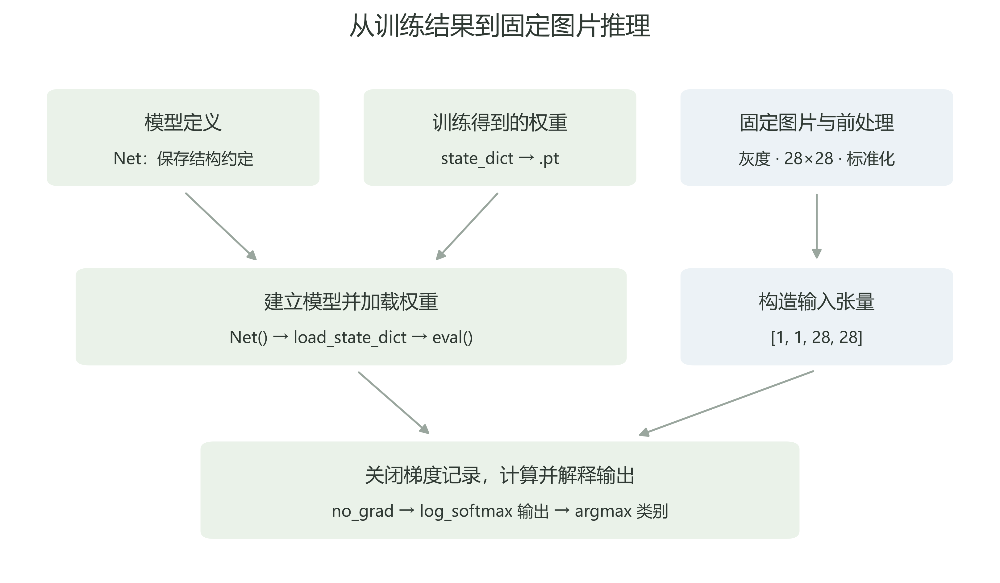 <!-- -->

<p align="center">图 2-11 保存、加载与推理路径</p>

图注：原创示意，依据本节流程与PyTorch官方MNIST示例绘制[3]。


### 2.4.6 推理模式与梯度设置

权重恢复后，我们就可以向模型输入图片并读取输出。输入沿模型中的各层运算传递、最终得到输出的过程，称为前向计算。训练和推理都会执行这一步；训练还要根据输出与真实标签计算损失，再通过反向传播求出梯度，供优化器更新参数。梯度描述参数变化对损失的影响，推理则使用已经确定的参数计算结果。

<p align="center">表 2-4 训练与推理环节的区别</p>

| 环节 | 本例训练时 | 本例推理时 |
| --- | --- | --- |
| 输入图片并前向计算 | 需要 | 需要 |
| 真实标签 | 用于计算损失 | 单张预测不需要；评估正确率时用于核对 |
| 损失计算 | 用来衡量预测与标签的差异 | 只输出类别时不需要；测试评价可计算损失 |
| 反向传播 | 计算参数梯度 | 不执行 |
| 优化器更新 | 调整模型参数 | 不执行 |
| 模型模式 | `train()` | `eval()` |
| 梯度记录 | 为反向传播保留 | 本节用`no_grad()`关闭 |

本例推理需要处理两项设置。首先，官方MNIST模型使用Dropout，在训练时随机将部分输入置零；评估时，该模块保留传入值。调用`eval()`可以让它切换到评估行为。其次，推理无需根据输出更新参数，因此可以用`torch.no_grad()`关闭代码块中的梯度记录，省去为反向传播记录运算过程的工作。两项设置分别控制模块行为和梯度记录，在推理中配合使用：`eval()`不会自动关闭梯度记录，`no_grad()`也不会自动切换模型模式[8]。

<p align="center">表 2-5 评估模式与梯度设置</p>

| 设置 | 本例中控制的行为 | 推理中的使用位置 |
| --- | --- | --- |
| `loaded_model.eval()` | Dropout按评估方式运行 | 加载模型后设置 |
| `with torch.no_grad():` | 代码块中的前向运算不建立反向梯度记录 | 包围模型前向调用 |

### 2.4.7 图像前处理与单图推理

MNIST使用28×28的单通道灰度图片。本例从图片文件读取数据时，先明确通道和尺寸，再把像素转换成浮点张量，并沿用训练时的数值处理规则。对于这里的8位灰度图，`ToTensor`将0—255的像素缩放到0—1，并组织为通道、高、宽三个维度；`Normalize`再按通道减去均值、除以标准差，这一步称为标准化。像素缩放与标准化是先后进行的两项操作，作用及参数应分别记录[3][9]。

下面读取第一张真实测试图片。它来自MNIST测试集索引0，标签为7；从本章目录运行以下代码，图片位于[../../../../assets/ch02/initial-draft/mnist_test_0000.png](../../../../assets/ch02/initial-draft/mnist_test_0000.png)。`image`保存灰度图片，`x`保存完成前处理并增加批次维度后的CPU输入：

```python
from PIL import Image
from torchvision import datasets, transforms

image_path = '../../../../assets/ch02/initial-draft/mnist_test_0000.png'
with Image.open(image_path) as source:
    gray_image = source.convert('L')                      # 将输入统一为单通道8位灰度图
    # 匹配训练输入尺寸
    image = gray_image.resize((28, 28), Image.Resampling.BILINEAR)
transform = transforms.Compose([
    transforms.ToTensor(),
    transforms.Normalize((0.1307,), (0.3081,)),           # 与官方示例一致的前处理
])
x = transform(image).unsqueeze(0)                         # 从[1,28,28]增加批次维度
print(x.shape, x.dtype)
```

灰度化使输入与模型要求的单通道表示一致。这里的尺寸调整属于外部图片文件的读取流程，用于统一输入大小；本次MNIST原图已经是28×28，因此这一步不改变尺寸。直接从MNIST数据集读取原生图片时，可以从`ToTensor`开始处理，无需额外执行尺寸调整。两种入口最终都应提供相同尺寸、像素含义和标准化规则的张量。

本例采用官方MNIST示例中的均值与标准差[3]。对8位灰度像素，缩放与标准化的计算可合并写为

$$
x=\frac{p/255-\mu}{\sigma},\qquad
\mu=0.1307,\quad \sigma=0.3081.
\tag{2-14}
$$

式（2-14）中，$p$为0—255之间的原始像素值，$\mu$和$\sigma$分别是对缩放后像素采用的均值与标准差，$x$为输入张量中对应的标准化数值。先除以255完成像素缩放，再减均值、除标准差。因此黑色像素0约变为-0.4242，白色像素255约变为2.8215；标准化结果不再限制在0—1范围内。训练和推理沿用相同参数，像素数值才具有一致的含义。

<p align="center">表 2-6 前处理各阶段的张量与数值</p>

| 操作后 | 形态或形状 | 数据含义 |
| --- | --- | --- |
| 读取并灰度化 | PIL灰度图片，28×28 | 8位像素值0—255 |
| 尺寸调整（本例调用resize） | 仍为28×28灰度图 | 外部图片统一尺寸；原生MNIST图片可省略 |
| ToTensor | `[1,28,28]`，float32 | 添加通道维，数值缩放至0—1 |
| Normalize | `[1,28,28]`，float32 | 按训练参数调整像素数值 |
| unsqueeze(0) | `[1,1,28,28]`，float32 | 在最前面添加图片数量这一维 |

打印结果为`torch.Size([1, 1, 28, 28]) torch.float32`。四个维度依次对应图片数量、通道数、高和宽。本次输入一张单通道图片，因此前两维都是1。

输入准备完成后，在关闭梯度记录的代码块中调用模型。官方模型最后使用`log_softmax`，返回每个数字类别概率的自然对数[3]。对这个输出取指数得到概率；沿类别维选择最大值的位置，就得到预测数字：

```python
with torch.no_grad():
    log_prob = loaded_model(x)                            # 返回形状[1,10]的对数概率
prob = log_prob.exp()                                     # 将对数概率转换成概率
predicted = log_prob.argmax(dim=1)                        # 在每张图片的10个类别中选择最大值
print('输出形状', log_prob.shape)
print('预测数字', predicted.item())
```

`log_prob`的第一维对应图片，第二维对应类别。`dim=1`让`argmax`在同一张图片的10个输出之间比较，并返回最大值所在的列号。对数函数保持数值的大小顺序，因此可以直接从对数概率中选择最大值；`exp()`用于需要查看概率时还原数值。

本次只输入一张图片，`predicted`中也只有一个类别索引，因此可以用`item()`取出这个数字。

输出形状为`torch.Size([1, 10])`。使用原固定图片实验的权重时，预测数字为7。这里每列依次对应数字0—9，`argmax`得到的类别索引正好与数字类别相同。使用其他分类任务时，应按该模型的类别表解释索引。

### 2.4.8 前处理变化对推理结果的影响

为了观察前处理的作用，保持权重和推理设置一致，固定选取MNIST测试集索引0—999，每次改变一个条件：跳过标准化、反转图片黑白关系，或者去掉输入的通道维。前两项仍能构成可计算的输入，错误形状则用来观察接口报错。

先读取固定的1000张原始测试图片。这里使用已经下载到`data`目录的MNIST数据集，`images`保存原始PIL图片，`labels`保存真实数字。前面已经定义的`transform`构造正确输入`x_good`，作为后续对照：

```python
test_set = datasets.MNIST(
    'data', train=False, download=False
)                                                         # 读取已下载测试集，此处不自动前处理
indices = list(range(1000))
images = [test_set[i][0] for i in indices]
labels = torch.tensor([test_set[i][1] for i in indices])
# [1000,1,28,28]
x_good = torch.stack([transform(image) for image in images])
```

随后构造两个只改变一项条件的输入。`x_no_norm`只做像素缩放，跳过减均值、除标准差；`x_inverted`先将原像素`p`变为`255-p`，再做原来的标准化。二者都保留通道和批次形状：

```python
from PIL import ImageOps

to_tensor = transforms.ToTensor()
x_no_norm = torch.stack([to_tensor(image) for image in images])
x_inverted = torch.stack([transform(ImageOps.invert(image)) for image in images])
```

下面的`predict_batch`保持相同模型和推理设置，把每组输入分批送入CPU，得到每张图片的预测类别。分批处理控制一次前向计算的数据量；评价时仍覆盖固定的全部1000张图片：

```python
def predict_batch(batch):
    outputs = []
    with torch.no_grad():
        for chunk in batch.split(100):
            outputs.append(loaded_model(chunk))
    return torch.cat(outputs).argmax(dim=1)               # 合并后沿类别维选择预测

pred_good = predict_batch(x_good)
for name, batch in [('correct', x_good), ('no_normalize', x_no_norm),
                    ('inverted', x_inverted)]:
    prediction = pred_good if name == 'correct' else predict_batch(batch)
    correct = (prediction == labels).sum().item()
    changed = (prediction != pred_good).sum().item()
    print(name, '正确数', correct, '改变预测数', changed)
```

对于形状错误，单独从正确输入中去掉大小为1的通道维。`try`和`except`记录实际报错，使程序能够继续完成其他对照：

```python
x_bad_shape = x_good.squeeze(1)                           # [1000,1,28,28]变为[1000,28,28]
shape_error = None
try:
    with torch.no_grad():
        loaded_model(x_bad_shape)
except RuntimeError as error:
    shape_error = str(error)
    print('错误形状', tuple(x_bad_shape.shape), shape_error)
```

下表记录了这组前处理对照的结果。原实验系统记录为Windows（构建号26200），软件环境为Python 3.11.16、PyTorch 2.5.1+cu121、torchvision 0.20.1+cu121和NumPy 1.26.4。推理使用CPU、float32和4个线程，模型处于评估模式，前向计算关闭梯度记录，每批计算100张图片。

原实验沿用官方Net定义，采用本地训练3轮后保存的最终权重。复现表中数值需加载原实验提供的权重。训练使用NVIDIA GeForce RTX 3050 Laptop GPU；表中的对照结果均来自CPU推理，统计范围为MNIST测试集索引0—999的1000张固定图片。各组共用同一权重、图片顺序和运行设置，仅改变表中指定的前处理条件。

<p align="center">表 2-7 固定1000张图片的前处理对照</p>

| 处理条件 | 输入形状 | 正确数 | 相对正确前处理改变预测的图片数 |
| --- | --- | --- | --- |
| 正确前处理 | [1000,1,28,28] | 987/1000 | 0 |
| 跳过Normalize，其余保持一致 | [1000,1,28,28] | 984/1000 | 15 |
| 黑白反转后按原规则标准化 | [1000,1,28,28] | 516/1000 | 486 |
| 去掉通道维 | [1000,28,28] | 运行报错 | 不适用 |

跳过标准化后，正确数只减少3张，但有15张图片的预测类别发生变化。预测改变既可能使原本错误的图片变为正确，也可能使原本正确的图片变为错误，因此改变预测的图片数与正确数的变化量含义不同。标准化变化还会改变完整输出，因此核对输入时，需要同时比较前处理规则和输出数值。

黑白反转后，张量形状和值域保持不变，笔画与背景的关系却发生了变化。反色组的正确数下降到516，表明输入除了符合形状要求，还需要保持训练时的笔画与背景关系。

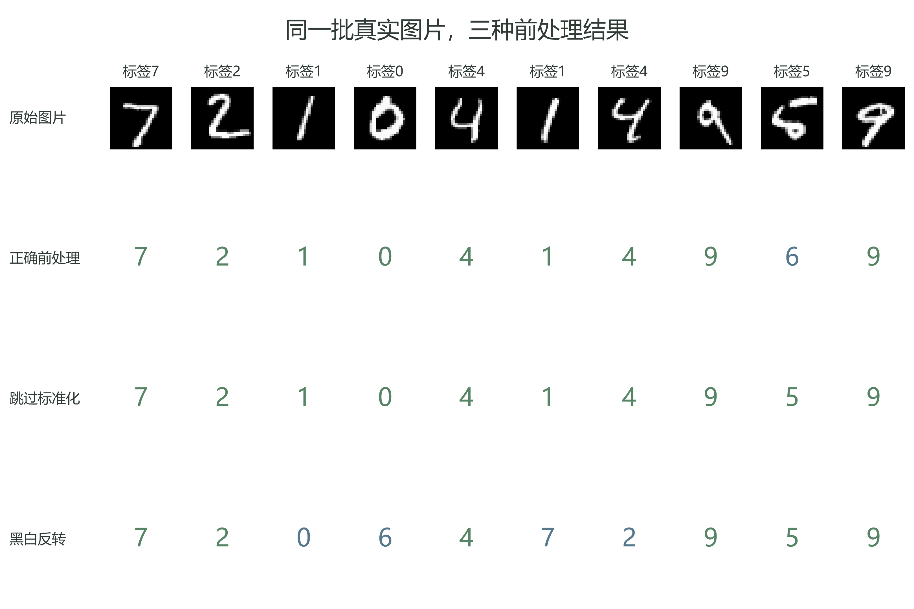 <!-- -->

<p align="center">图 2-12 固定图片的前处理对照</p>

图注：图片取自MNIST测试集索引0—9，预测来自本节原实验；绿色表示预测正确，蓝色表示预测错误。


错误形状实验从`[1000,1,28,28]`中去掉通道维，得到`[1000,28,28]`。卷积把三维输入按单张图片的通道、高、宽解释，因此把1000视为通道数，与模型要求的1个通道冲突。实际错误包含`to have 1 channels, but got 1000 channels instead`。这类问题需要先检查张量的每一维含义，再调整模型调用。

保存模型定义、权重、固定图片和前处理结果后，我们就能在转换模型时继续使用同一组材料，核对转换前后的输入与输出。下一节先介绍完成这种转换所需的模型交换格式。

## 2.5 ONNX模型交换格式

在2.4节中，我们已经按`Net`定义加载权重，将图片处理成输入张量，并由PyTorch计算出预测结果。接下来，要在其他推理工具中继续使用这个模型，就需要让工具读懂模型中的运算、参数以及输入输出约定。ONNX提供了一种共同的模型表示，使我们能够从PyTorch出发，继续准备ARM CPU、RK3588和海思等环境中的部署。

### 2.5.1 模型交换格式的作用

在PyTorch程序中，`Net`描述各层怎样连接，`state_dict`保存相应参数和已登记缓冲区。两者配合，能够恢复模型的计算。设备上的程序可能使用另一种推理引擎，也就是负责组织和执行模型计算的软件。它需要读取自己能够理解的模型表示，才能确定输入经过哪些运算、各项运算使用什么参数。

为了在不同工具之间保留这些信息，我们需要用共同的规则描述计算关系、参数和输入输出，这就是模型交换格式的作用。ONNX的英文全称为Open Neural Network Exchange，通常称为开放神经网络交换格式。训练框架可以按这套约定生成模型，支持它的推理引擎或厂商工具链再读取并处理。对于本章的MNIST模型，保留的功能是接收手写数字图片张量，输出十个数字类别的对数概率。

把原框架中的模型转换为ONNX表示并保存下来，称为导出。导出器将模型计算映射到ONNX的表达，同时保存参数与输入输出信息。2.4节的保存操作让我们能够恢复训练参数；导出则进一步让其他工具能够读取模型的计算。具体操作将在2.7节展开。

### 2.5.2 ONNX模型的组成

一次推理中，输入先参与某项运算，产生的结果再传给后续运算，直到形成模型输出。将这些运算及其数据传递关系组织起来，就得到计算图。图中的节点表示运算，运算的定义称为算子。2.6节将结合MNIST逐层观察计算图，本节先从整体上认识模型包含的信息。

<p align="center">表 2-8 ONNX模型的组成</p>

| 组成 | 作用 | 本章MNIST中的对应内容 |
| --- | --- | --- |
| 计算关系 | 描述输入经过哪些运算，以及数据的传递关系 | 从图片张量到十类输出的计算 |
| 参数与常量 | 提供计算所需的已确定数值 | 卷积层、全连接层使用的权重等 |
| 输入输出描述 | 约定名称、形状和数据类型等接口 | 单张灰度图片张量与十类输出 |
| 版本和描述信息 | 说明采用的模型表达规则及来源 | 格式、算子集和模型修订等信息 |

ONNX通过一个模型对象组织这些内容，这个最外层对象称为`ModelProto`。它包含计算图，也记录生成模型的工具、所用格式的版本等信息。这些描述模型来源和读取条件的信息，统称为元信息，便于后续选择工具和核对版本。

权重等在推理时保持不变的数值，可以作为图的初始化项保存，通常写作`initializer`[10]。模型中的计算关系和数值按格式规则编码为可存储、可传输的字节，这个过程称为序列化。常见模型以`.onnx`为文件扩展名；权重既可以放在模型文件内部，也可以保存在模型引用的外部数据文件中。使用外部数据时，需要让模型文件与其引用的数据文件保持正确的相对位置[10]。

模型的输入输出还取决于导出时选定的计算范围。本章`Net`接收已经处理好的张量；读取图片、必要的灰度化与尺寸调整、像素缩放及标准化均由图外的调用程序完成，其中原生MNIST图片不需要额外改变尺寸。按这个范围导出后，我们仍需在调用程序中准备相同的输入，并在取得输出后选择类别、组织业务结果。读取模型时，先明确这些操作各自的位置，才能安排完整的推理流程。

### 2.5.3 模型格式、转换工具与运行时

模型文件描述怎样计算，执行时还需要软件读取这些描述、接收输入并返回输出。这类软件称为运行时，常写作Runtime。本章将ONNX Runtime作为跨平台推理引擎使用；Python程序通过`onnxruntime`库调用其接口，加载支持的模型并组织计算[11]。

这里，“推理引擎”说明它承担的计算职责，“Python库”说明程序使用它的方式。ONNX规定模型怎样表示，ONNX Runtime负责读取并执行支持的计算；PyTorch则是本章定义和训练模型所用的框架。2.7节将通过创建会话、传入张量和读取输出来展示具体调用过程。

面向厂商平台部署时，模型通常还要经过转换。转换工具把ONNX中的计算和参数整理成目标运行库能够加载的表示，生成平台专用模型。完成转换与部署所需的一组工具，称为工具链。板端应用通过运行库提供的接口加载模型、传入数据和读取结果，设备驱动则承担相应的硬件访问与控制。开发时使用的软件开发工具包，通常简称SDK，会提供相关接口、库和辅助工具。


<p align="center">表 2-9 模型文件与工具的职责</p>

| 对象 | 性质 | 主要职责或保存内容 | 输入要求或产物 |
| --- | --- | --- | --- |
| PyTorch | 训练框架与计算软件 | 定义、训练和执行模型 | 训练后的模型可继续导出 |
| 本章保存的.pt文件 | PyTorch状态字典文件 | 保存参数和已登记缓冲区 | 与对应的`Net`定义配套加载 |
| ONNX导出器 | 转换工具 | 将原框架计算表达为ONNX | 生成ONNX模型及可能的外部权重数据 |
| ONNX模型 | 模型交换表示 | 保存计算关系、参数和接口等信息 | 由支持它的运行工具或平台转换工具读取 |
| ONNX Runtime | 本章使用的跨平台推理引擎 | 加载支持范围内的模型并组织计算，提供Python等调用接口 | 接收输入张量，返回输出张量 |
| RKNN-Toolkit2 | 瑞芯微转换与开发工具 | 导入支持的模型，完成转换并导出RKNN模型 | 得到供目标平台使用的RKNN模型 |
| RKNN模型 | 平台专用模型 | 保存该工具链产生的平台模型表示 | 由匹配的RKNN板端运行软件加载 |
| RKNN Runtime／RKNN-Toolkit-Lite2 | 板端运行软件及接口 | 分别提供C/C++或Python部署接口 | 调用目标瑞芯微NPU完成模型计算 |
| 海思平台配套模型转换工具 | 模型转换工具 | 将ONNX转换为目标平台使用的离线模型；采用ATC的配套工具链可生成.om文件 | 得到目标平台支持的离线模型 |
| 海思平台离线模型 | 平台专用模型文件 | 保存转换工具生成的模型表示，具体格式由目标平台工具链确定 | 由匹配的板端运行库加载 |
| 海思平台配套运行接口和运行库 | 平台运行接口与软件库 | 供应用加载并执行平台模型；采用SVP ACL的平台使用相应接口与库 | 返回设备侧模型输出 |

表 2-9 按ONNX模型规范、ONNX Runtime文档及两类厂商工具文档整理[10][11][12][13]。这些对象共同组成部署过程中的计算环节：模型文件保存计算描述，运行软件执行相应运算，并通过驱动使用硬件。应用程序还需要将图像采集、前处理、模型执行、类别解释与业务输出连接起来，才能把模型结果用于实际任务。

### 2.5.4 三类平台的部署路径

本书第二章先建立共同的模型与输入输出基础，第五至七章再介绍不同设备上的部署。三类环境都可以从导出的ONNX模型出发，差别主要在后续使用的工具和模型产物，如图 2-13 所示。

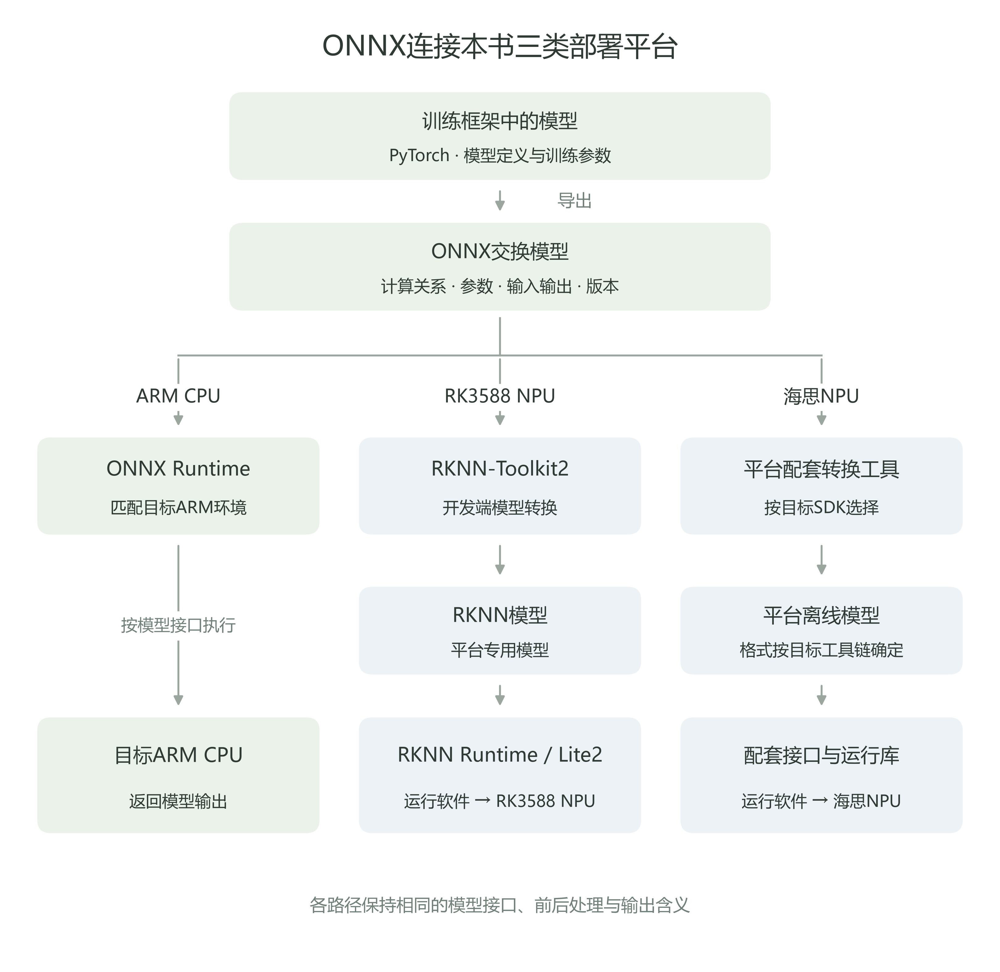 <!-- -->

<p align="center">图 2-13 ONNX连接本书三类部署平台</p>

图注：原创概念图，依据模型交换流程及平台工具文档绘制[10][11][12][13]，不表示已经完成三平台实测。


ARM CPU方向以ONNX Runtime为例。我们使用匹配目标ARM架构和操作系统的运行库加载ONNX模型，提供符合接口要求的输入张量，再读取推理输出。这条路径中，ONNX Runtime直接读取ONNX表示并执行计算。

RK3588方向需要先使用RKNN-Toolkit2转换模型，生成RKNN模型。板端应用随后通过RKNN Runtime或RKNN-Toolkit-Lite2提供的接口加载和使用模型，相关运行软件与NPU驱动配合完成计算。

海思方向也需要使用目标平台配套的转换与运行软件，先将ONNX转换为板端能够加载的离线模型，再通过配套接口传入张量、取得结果。在采用ATC和SVP ACL的海思配套工具链中，可以将ONNX编译为`.om`离线模型，并通过SVP ACL接口与运行库加载执行。这一工具链示例依据海思对应平台的官方快速上手文档[13]；选择其他海思平台时，仍需根据各自SDK确定模型格式、接口和支持范围。

三条路线保留同一个识别任务及其输入输出含义，同时采用各自支持的模型表示和执行软件。沿某条路线部署时，我们需要先核对该工具能否处理模型中的运算与输入条件，再进行转换和结果验证。

### 2.5.5 ONNX兼容性与输入约束

工具能够读取ONNX格式，还需要支持模型实际使用的运算和数据。检查兼容性时，我们先确定目标工具与平台版本，再核对模型的格式规则、运算定义及输入输出条件。

ONNX模型的结构描述采用一套统一规则，称为中间表示，英文为Intermediate Representation，简称IR。IR版本规定模型结构怎样表达，算子集版本则规定其中各项运算怎样解释，两者是不同的版本信息[10]。模型相关的版本信息见下表。

<p align="center">表 2-10 ONNX相关版本信息</p>

| 版本信息 | 说明什么 | 检查目的 |
| --- | --- | --- |
| ONNX工具库版本 | 读写、检查模型所用软件的发布版本 | 确认该工具具备的处理能力 |
| IR版本，即ir_version | 模型结构采用的格式规则 | 判断目标工具能否理解这些结构 |
| 算子集版本，即opset | 一组运算所采用的定义版本 | 判断图中运算按哪套规则解释 |
| 模型版本，即model_version | 制作者登记的模型修订信息 | 区分模型自身的修订 |

opset是operator set的缩写，即算子集。运算定义更新后，输入、属性或行为可能变化，因此需要记录采用哪一版规则。模型通过`opset_import`记录算子集所属域与版本，其中域用于区分不同组织定义的运算集合。导出时，应同时考虑导出器能够表达的运算，以及目标工具能够解释和执行的版本。

确定算子版本后，还要检查实际配置和数据类型。以卷积为例，属性中会记录步长等固定设置；数据类型则说明参与运算的数值采用何种表示。目标工具对某类算子的支持可能只覆盖部分配置和类型，因此要把模型实际使用的条件与工具的支持范围逐项对应。

输入形状也需要匹配。2.4节单张MNIST输入为`[1,1,28,28]`，采用`float32`，即32位浮点表示；四维依次为批次数、通道数、高和宽。如果接口将这些维度的大小固定，调用时就需要提供相同形状，这称为固定形状。

处理不同数量的图片时，可以允许批次数变化，并在接口中用符号表示这一维，这称为动态形状。输入`[N,1,28,28]`中的`N`表示批次数，相应的十类输出可写成`[N,10]`；通道数与图片高宽仍保持1、28、28。实际能够使用哪些批次数，需要结合图内计算与目标工具支持确定。

图片高宽还受到模型内部计算的约束。本章`Net`在展平后接入按固定特征数建立的全连接层，改变高宽会改变送入这一层的数据大小。因此，检查形状时既要查看输入声明，也要查看后续运算的要求，并按目标平台工具的支持条件选择固定或动态接口。

数值处理与形状共同决定输入的含义。两个形状均为`[1,1,28,28]`的浮点张量，可以分别存储0—1像素值和标准化后的值。2.4节的对照已经展示了这种差别对结果的影响。我们在其他工具中继续使用模型时，还需要沿用灰度规则、尺寸处理、标准化参数、数据布局和类别顺序。

模型转换后，需要检查文件结构、实际运行和数值结果。我们先用ONNX检查器核对模型结构，再让运行工具加载模型，最后用相同输入比较转换前后的完整输出。2.7节将完成这条验证路径。

## 2.6 计算图、算子与模型结构

2.4节用MNIST模型识别了手写数字。把一张28×28的灰度图片处理成张量后，模型怎样从中算出对应10个数字的结果？我们先沿`Net.forward`追踪数据，再用一张已经导出的ONNX计算图核对这些操作。2.5节介绍了ONNX格式，2.7节会沿用这套模型结构演示导出。

手写数字识别推动了早期卷积网络的发展。LeNet-5用卷积提取局部特征，再缩小特征图并完成分类[6]。本章选用PyTorch官方MNIST示例中的`Net`[3]，这个模型用两层卷积和ReLU提取特征，通过最大池化缩小特征图，再用两层全连接完成分类。输入为28×28灰度图，CPU即可完成推理对照。模型用到的算子较少，我们可以逐层查看形状和数值，并核对导出器与运行时是否支持这些算子。设备上的速度与兼容性需按实际工具链验证。

### 2.6.1 从源码读计算图

计算图（computational graph）把计算操作画成节点，用带箭头的边连接起来。箭头表示张量从哪一步传到哪一步。顺着它，我们能看到某一步的结果交给了谁；反过来看，则能查到当前操作需要哪些输入。模型结构规定这些操作怎样连接，权重和偏置提供计算参数，各步产生的数据保存在中间张量中。

工程`src/main.py`中的`Net`定义了模型结构。`__init__`创建卷积、全连接等层，`forward`写明张量经过这些层的顺序。`nn`提供层，`F`提供激活、池化等函数。我们对照下面的代码和图 2-14，追踪每次计算后的张量形状。

```python
import torch
import torch.nn as nn
import torch.nn.functional as F


class Net(nn.Module):
    def __init__(self):
        super(Net, self).__init__()
        self.conv1 = nn.Conv2d(1, 32, 3, 1)      # 1个输入通道，32个输出通道
        self.conv2 = nn.Conv2d(32, 64, 3, 1)
        self.dropout1 = nn.Dropout(0.25)
        self.dropout2 = nn.Dropout(0.5)
        self.fc1 = nn.Linear(9216, 128)
        self.fc2 = nn.Linear(128, 10)

    def forward(self, x):
        x = self.conv1(x)
        x = F.relu(x)
        x = self.conv2(x)
        x = F.relu(x)
        x = F.max_pool2d(x, 2)
        x = self.dropout1(x)
        x = torch.flatten(x, 1)                  # 保留批次维
        x = self.fc1(x)
        x = F.relu(x)
        x = self.dropout2(x)
        x = self.fc2(x)
        output = F.log_softmax(x, dim=1)
        return output
```

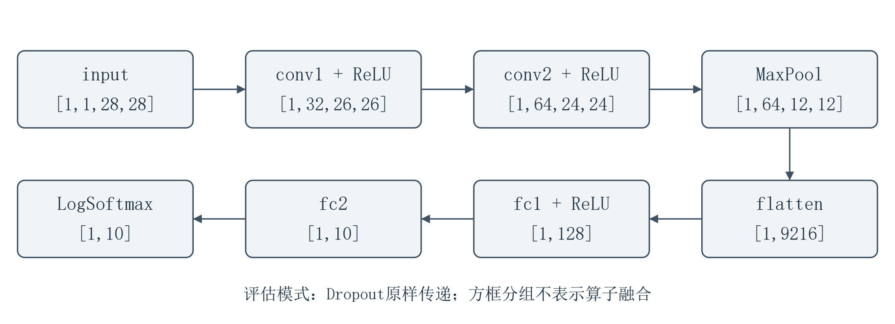 <!-- -->

<p align="center">图 2-14 MNIST模型的计算主路径与输出形状</p>

`x`起初是一张经过2.4节前处理的图片，形状为`[1,1,28,28]`。`self.conv1(x)`的结果赋回`x`，下一行`F.relu(x)`就以卷积的结果为输入。图 2-14 用箭头表示这种依赖。沿图查看形状时，第一维始终为1，对应这张图片。第二维先变为32、再变为64，记录卷积产生的通道数。

### 2.6.2 数据、参数与属性

第一层卷积接收图片时，还要用到这一层的权重和偏置。图片来自本次输入，参数来自训练后保存的模型；步长、补边等属性（attribute）则规定窗口怎样移动、怎样处理边缘。表 2-11 把同一节点涉及的几类信息列在一起。

<p align="center">表 2-11 第一层卷积的数据、参数和属性</p>

| 对象 | 本模型中的内容 | 作用 |
| --- | --- | --- |
| 图片输入 | input：[1,1,28,28] | 当前要处理的数据 |
| 权重输入 | conv1.weight：[32,1,3,3] | 局部乘加使用的乘数 |
| 偏置输入 | conv1.bias：[32] | 每个输出通道额外加入的数 |
| 节点属性 | strides=[1,1]；pads=[0,0,0,0] | 步长为1，不补边 |
| 输出 | [1,32,26,26] | 一张图片对应32张26×26特征图 |

沿卷积输出的高、宽查看，数值仍按空间位置排列，这样的结果称为特征图（feature map）。每个输出通道保存一张特征图，具体响应取决于权重和输入，通道编号本身不表示横线或竖线。这份ONNX模型用初始化张量（initializer）保存4份权重和4份偏置，共8个参数张量；initializer也可以保存其他常量。换一张图片，模型仍用原来的参数计算，特征图和最终输出随图片而变。

### 2.6.3 算子与张量变换

从第一层卷积到最后的分类输出，每一步都有自己的计算规则。这类规则称为算子（operator），它规定接收什么输入、怎样计算、产生什么输出。下面沿图 2-14 依次看这些操作，同一种算子可以在多个节点使用。

**1. 卷积与激活**

卷积从图片的局部区域计算特征。图 2-15 中的窗口覆盖一小块输入，卷积核（kernel）为窗口内的各个位置提供权重。对应元素相乘，乘积求和后加上偏置，就得到输出中的一个数。窗口移到下一处时继续使用这组权重，这叫权重共享。这里卷积核保持原方向，采用互相关规则，神经网络中通常仍称为卷积。

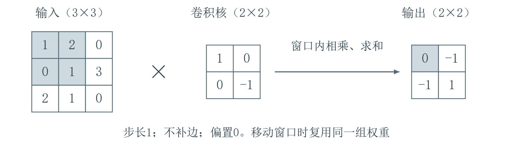 <!-- -->

<p align="center">图 2-15 卷积窗口移动与权重复用</p>

多通道卷积将各输入通道的局部乘加结果相加，最后加一次偏置。换一套核和偏置，就得到另一个输出通道。**输入通道参与求和，输出通道分别计算。**因此，第一层权重`[32,1,3,3]`表示32套核，每套覆盖1个输入通道。第二层`[64,32,3,3]`则有64套核，每套覆盖32个输入通道。

步长（stride）决定窗口每次移动的距离，补边（padding）决定是否在边缘补充位置。本模型使用3×3核、步长1、不补边，两层输出的空间尺寸依次为26×26和24×24。随后使用ReLU改变数值，张量形状保持不变。对每个输入值$x$，ReLU保留非负值，将负值置零。

$$
\operatorname{ReLU}(x)=\max(0,x)
\tag{2-15}
$$

**2. 池化与展平**

经过两层卷积后，每张图片对应64张24×24的特征图。接下来，最大池化（max pooling）在每个通道内取局部窗口的最大值，缩小每张特征图。池化窗口没有需要训练的权重。图 2-16 把池化和后面的展平（flatten）放在一起，方便我们看清数据经历的两次变化。

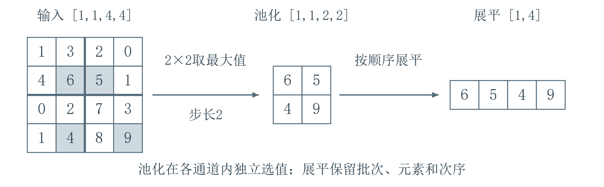 <!-- -->

<p align="center">图 2-16 最大池化减少位置，展平合并维度</p>

池化使用2×2窗口、步长2、不补边，把24×24缩为12×12，通道数仍为64。随后，`torch.flatten(x,1)`保留批次维，把这64张特征图中的数按原顺序排成一行，得到`[1,9216]`。展平保留全部元素，长度$F$由通道数和空间尺寸决定。

$$
F=64\times12\times12=9216
\tag{2-16}
$$

这一行中的各个位置都对应后续全连接层的权重，因此展平时要保持原有顺序。

**3. 全连接与分类输出**

排成一行的9216项特征进入`fc1`。全连接层为每个输出使用一组权重，将全部输入与相应权重相乘、求和，再加偏置。`fc1`由此得到128项结果，`fc2`再把它们变成10个分类分数。图 2-17 对照了`fc1`的输入与权重形状。ONNX用Gemm表示这次矩阵乘加，文件中的权重为`[128,9216]`，`transB=1`表示乘法使用它的转置。

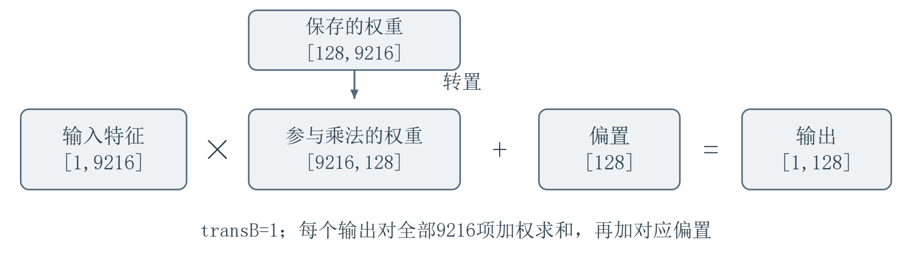 <!-- -->

<p align="center">图 2-17 第一层全连接的矩阵乘加</p>

这10个分数依次对应数字0至9，称为原始分类分数，即logits。它们可以为负，总和也不要求为1。softmax把分数转换为总和为1的概率，LogSoftmax计算这些概率的自然对数。对数概率可以为负，各类别的大小顺序保持不变。本模型沿类别轴`dim=1`计算，返回形状为`[1,10]`的一行对数概率。调用程序在模型外用$\arg\max$找到最大值所在的列，按类别顺序读出预测数字。选择类别之前的整行对数概率，就是2.7节要逐项比较的原始输出。

**4. Constant、Concat与Reshape**

在源码里，展平只用了一行。到了ONNX图中，我们会看到Reshape旁边多出一条支路，如图 2-18 所示。特征数据从主路径传来，这条支路提供展平后的目标形状。Constant无需接收数据，直接输出节点属性中保存的常量张量；Concat沿`axis`指定的轴，按输入顺序把张量接在一起，元素值保持原样。参与拼接的张量须类型和维数相同，拼接轴以外的尺寸也要一致。

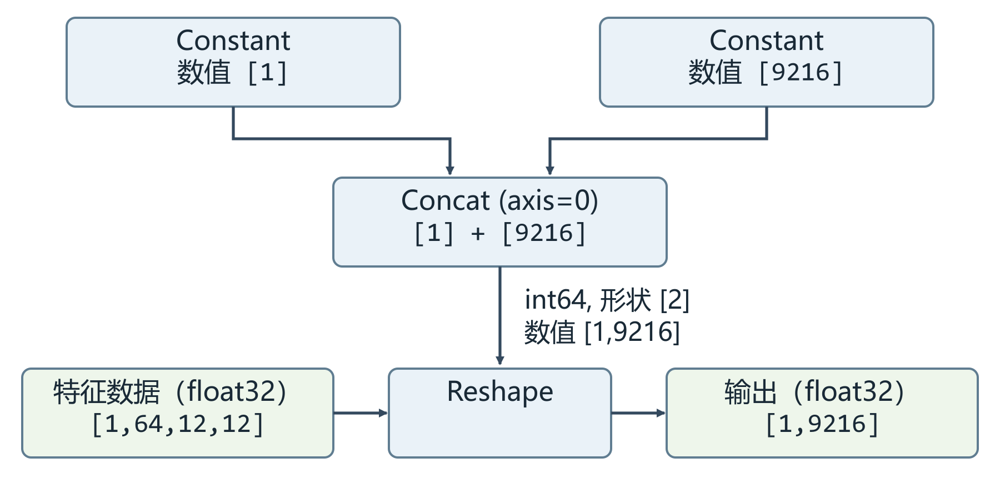 <!-- -->

<p align="center">图 2-18 Reshape的特征输入与形状输入</p>

两个Constant分别提供`[1]`和`[9216]`，Concat沿第0轴拼成`[1,9216]`。这份int64张量含有两个整数，自身形状是`[2]`。Reshape据此把另一路float32特征排成1行9216列，元素总数和顺序都保持原样。形状支路只提供尺寸，图片数据仍从原来的入口进入，也不需要新增训练参数。Constant通过节点输出常量，initializer则直接在模型文件中保存张量。

源码中的Dropout在训练时随机置零一部分数值并缩放保留值。评估时Dropout原样传递输入，所以导出图省去了这些节点，Conv和Relu各自保留。

### 2.6.4 输入形状、布局与算子版本

表 2-12 将源码操作与ONNX表达对应起来。我们先核对主路径，再看图 2-19 中的完整连接。

<p align="center">表 2-12 模型主要操作、参数与形状</p>

| 源码操作 | ONNX表达 | 参数形状或设置 | 输出形状 |
| --- | --- | --- | --- |
| 输入 | input | float32、NCHW | [1,1,28,28] |
| conv1、ReLU | Conv、Relu | 权重[32,1,3,3]，偏置[32] | [1,32,26,26] |
| conv2、ReLU | Conv、Relu | 权重[64,32,3,3]，偏置[64] | [1,64,24,24] |
| 最大池化 | MaxPool | 窗口2×2，步长2 | [1,64,12,12] |
| 展平 | Reshape及形状支路 | 目标形状[1,9216] | [1,9216] |
| fc1、ReLU | Gemm、Relu | 权重[128,9216]，偏置[128] | [1,128] |
| fc2 | Gemm | 权重[10,128]，偏置[10] | [1,10] |
| 对数概率 | LogSoftmax | 类别轴为1 | [1,10] |

沿前面的路径计算时，我们始终输入一张图片。这份图把输入各维固定为`[1,1,28,28]`，称为静态形状（static shape）。若一次处理多张图片，可以把批次N设置为动态维度（dynamic dimension），让这一维在约束下变化，但图内的计算也要配合。只改输入端的标签，展平目标仍是`[1,9216]`。图片高宽改变后，展平长度还可能与`fc1`要求的输入长度不符。

NCHW按批次、通道、高、宽排列，NHWC按批次、高、宽、通道排列，换布局需要交换轴。Reshape只能改变形状，仍按原顺序读取元素。算子集版本（opset）规定图中的算子按哪一版规则解释。图 2-19 采用标准ONNX域的opset 20。2.7节导出的基线采用opset 17，只让批次维变化，仍接收NCHW排列的28×28灰度图。

我们从图顶部`input`追踪特征，到Reshape时查看右侧形状支路，再沿Gemm到达底部`log_probs`。图中Conv的W、B表示权重、偏置，Gemm的B、C表示矩阵乘加参数，须结合节点和形状辨认。全图有13个计算节点，图输入、图输出和8个initializer不计入其中。在[Netron](https://netron.app/)中打开模型并选中节点，即可查看属性。数值一致性和设备兼容性还要分别检查。

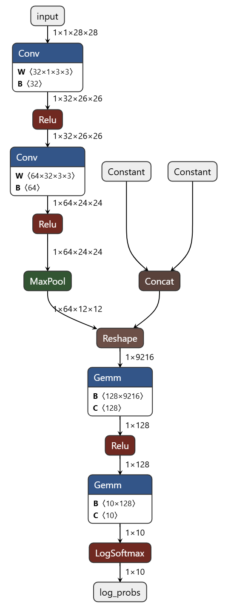 <!-- -->

<p align="center">图 2-19 原始MNIST模型的完整ONNX计算图</p>

图注：Netron 9.3.1。

### 2.6.5 按版本查阅算子定义

读过这份MNIST图后，换一个模型可能会遇到新节点。我们先从节点记录中找出算子类型`op_type`、所属域`domain`，再查看模型为这个域登记的opset，带着这三项信息去[ONNX官方算子索引](https://onnx.ai/onnx/operators/index.html)[14]查找。节点名称可能由导出器生成，检索时用算子类型。标准域在文件中可为空字符串，通常显示为`ai.onnx`。

找到算子后，我们选不高于模型opset的最新适用版本。先读Summary了解算子的作用，再用Inputs和Attributes分辨沿连线传入的值和写在节点里的设置，并查看默认值。接着读Outputs和Type Constraints，核对输出形状和数据类型。例如，opset 20模型中的ReduceMean应读18版，其中`axes`是可选输入，13版把它写成属性。`keepdims`决定求平均后是否保留被缩减的维度。最后回到实际节点核对取值。遇到自定义域，查阅提供方的说明。部署前还需核对目标工具能否处理模型实际使用的算子、属性、类型与形状。

2.7节将用同一套`Net`结构和配套权重另行导出模型。新文件将输出命名为`output`，每张图片仍对应按数字0至9排列的10个对数概率。我们会用同一批图片核对PyTorch和ONNX Runtime的完整输出。2.8节接着把输入和输出约定整理成部署接口。

## 2.7 模型导出与ONNX Runtime基线推理

理解计算图后，我们把MNIST卷积神经网络（CNN）导出为ONNX文件，再用同一批图片比较PyTorch与ONNX Runtime的输出。代码可使用2.4节保存的权重。下文的预测与误差数值来自本节原基线实验所用的权重，与2.4节前处理对照使用的是两份权重文件。ONNX文件保存模型的计算和参数，使后续运行工具能够加载它们。ONNX Runtime是跨平台的模型运行引擎，Python程序通过`onnxruntime`库调用它；本节使用其中的推理接口，检查导出模型与原模型的计算结果是否在预设容差内一致。

### 2.7.1 模型恢复与导出

沿用2.4节的加载方法，根据模型定义恢复权重。模型中的Dropout在训练时随机丢弃部分值，推理时需要保留输入值，因此调用`eval()`切换到评估模式，使它按评估规则运行。示例输入提供导出时所需的形状和数据类型。这里使用单张图片形状`[1,1,28,28]`，将批次数声明为动态维度；图片通道、高和宽保持固定。

```python
from pathlib import Path

import onnx
import onnxruntime as ort

weights_path = Path("mnist_cnn.pt")
onnx_path = Path("mnist_cnn.onnx")
model = Net().cpu()  # 在CPU上建立与训练时相同的模型结构
# 将已保存权重加载到CPU模型
model.load_state_dict(torch.load(weights_path, map_location="cpu", weights_only=True))
model.eval()        # 使Dropout等模块按评估规则运行
# 提供导出所需的输入形状与类型
example = torch.zeros(1, 1, 28, 28, dtype=torch.float32)
torch.onnx.export(
    model, example, str(onnx_path), export_params=True,
    opset_version=17,  # 使用后续运行工具支持的算子集版本
    input_names=["input"], output_names=["output"],
    # 输入输出共用动态批次维
    dynamic_axes={"input": {0: "batch"}, "output": {0: "batch"}},
    training=torch.onnx.TrainingMode.EVAL, do_constant_folding=True,
)
onnx.checker.check_model(onnx.load(str(onnx_path)))  # 检查导出文件的结构
```

`weights_path`和`onnx_path`分别指向权重与导出文件。输入名为`input`，输出名为`output`，`dynamic_axes`将两者的第0维都命名为`batch`。本例沿用实验所用的PyTorch 2.4.1传统导出接口，`opset_version=17`指定导出文件采用的ONNX算子集版本。`onnx.checker.check_model`检查文件是否符合ONNX结构规则；模型能否按预期接收数据并计算结果，还要通过下面的接口读取和推理对照来核对。

### 2.7.2 模型加载与接口读取

要运行模型，需要先加载 ONNX 文件。ONNX Runtime 通过会话（Session）加载并调用模型；创建会话后，就可以反复向它送入输入、取回输出。

送入图片前，我们需要知道模型接收什么样的数据、返回哪些结果。会话提供的名称、形状和数据类型等描述，合称元信息。名称用于对应输入入口和所需输出，形状说明数组的维度及各维大小，数据类型（dtype）说明元素采用的数值表示。

模型计算采用哪种实现，由会话中的执行提供者（Execution Provider）指定。本节让 CPU 完成运算，因此在创建会话时，将 `providers` 参数设为 `CPUExecutionProvider`。

下面使用刚刚导出的`mnist_cnn.onnx`，其路径保存在`onnx_path`中；代码中的`ort`是`onnxruntime`库的简称。我们创建CPU会话，读取并打印模型的输入输出要求：

```python
session = ort.InferenceSession(
    str(onnx_path), providers=["CPUExecutionProvider"]  # 加载模型，让CPU执行模型计算
)
inputs = session.get_inputs()    # 取得各项输入的元信息
outputs = session.get_outputs()  # 取得各项输出的元信息
for item in inputs:
    print("输入", item.name, item.shape, item.type)
for item in outputs:
    print("输出", item.name, item.shape, item.type)
print("执行提供者", session.get_providers())
```

`get_inputs()` 和 `get_outputs()` 分别返回输入、输出的元信息，循环将它们逐项打印。后续调用模型时，就使用这里读出的名称送入数据、请求结果。`get_providers()` 同时列出当前会话登记的执行提供者。

本次会话打印的结果为：

```text
输入 input ['batch', 1, 28, 28] tensor(float)
输出 output ['batch', 10] tensor(float)
执行提供者 ['CPUExecutionProvider']
```

输入名为 `input`，输出名为 `output`，`tensor(float)` 表示元素采用 32 位浮点数。形状中的 `batch` 表示一次送入的图片数量，它可以随实际输入变化，称为动态维度；其余输入维度固定为 1、28、28。本次送入 10 张图片，输入形状为 `[10, 1, 28, 28]`，输出形状为 `[10, 10]`。这些字段给出了当前 ONNX 文件的调用要求，各维的具体含义还要结合模型定义理解。

当前模型只有一项输入和一项输出。核对这一条件后，取出它们的实际名称，供后续调用使用：

```python
assert len(inputs) == 1 and len(outputs) == 1  # 核对本段使用的接口条件
input_meta, output_meta = inputs[0], outputs[0]
input_name = input_meta.name    # 后续送入数据时使用的实际输入名
output_name = output_meta.name  # 后续请求返回的实际输出名
```

读取元信息后，还需要把图片转换为符合这些要求的张量。图片的数值转换、数值范围调整和维度排列等操作，称为前处理。它们决定了模型实际收到的数据，因此两条推理路径需要复用同一份处理结果。

### 2.7.3 相同输入的推理对照

前处理沿用2.4节的`ToTensor`和`Normalize((0.1307,), (0.3081,))`。对于这里的MNIST灰度图片，`ToTensor`把像素值从0—255转换到0—1，并整理为`[1,28,28]`的`float32`张量；`Normalize`再将各像素值减去0.1307并除以0.3081。两条推理路径复用这一处理结果，使比较从同一份数值输入开始。

本次对照在Windows 10（构建号26200）的CPU上完成，系统处理器标识为`AMD64 Family 25 Model 68 Stepping 1, AuthenticAMD`。软件环境为Python 3.11.9、PyTorch 2.4.1、torchvision 0.19.1、NumPy 1.23.5、ONNX 1.17.0和ONNX Runtime 1.20.1。PyTorch使用6个线程，ONNX Runtime使用默认会话线程策略，并指定`CPUExecutionProvider`。

我们固定使用 MNIST 测试集索引 0 至 9 的 10 张图片。2.4.1节加载的 `test_data` 在读取样本时返回处理后的图片张量和标签。下面用 `torch.stack` 将这些图片叠成一个批次，作为两条推理路径共用的 CPU 输入：

```python
indices = list(range(10))  # 固定测试集索引0至9及其顺序
x_cpu = torch.stack([test_data[i][0] for i in indices])  # 叠成10张图片的批次
print(x_cpu.shape, x_cpu.dtype)
```

打印结果为 `torch.Size([10, 1, 28, 28]) torch.float32`。

四个维度依次表示样本数、通道数、高和宽，这种排列通常记为 NCHW，N、C、H、W 分别表示这四个维度。输入的后 3 维与 ONNX 要求一致，批量数 10 对应动态维度 `batch`。固定索引和排列顺序，也使两侧输出的每一行都能对应回同一张图片。

除了输入相同，两侧模型的运行状态也需要一致。前面导出时已将模型设为评估模式，PyTorch推理时也沿用这一状态，使Dropout按相同规则运行。这里的 `model` 已加载前文 `mnist_cnn.pt` 中的权重，ONNX 模型也由同一权重在评估模式下导出。

训练时，PyTorch 需要记录运算过程，以便计算用于调整参数的梯度。本次只计算输出，可以用 `no_grad()` 停用梯度记录。这项设置与 `eval()` 配合使用，分别控制梯度记录和模块的运行行为。

下面让 PyTorch 模型在 CPU 上计算已有输入 `x_cpu`。ONNX Runtime 接收 NumPy 数组，因此将同一份 CPU 张量转为数组，再按前面读取的输入输出名称调用会话：

```python
model = model.to("cpu")  # 将已加载权重的模型放到CPU
model.eval()             # 使用评估模式运行包含Dropout的模型
with torch.no_grad():    # 本次前向运算不记录梯度
    torch_output = model(x_cpu)

x_numpy = x_cpu.detach().numpy()  # 将同一份CPU输入转换为NumPy数组
ort_output = session.run(
    [output_name], {input_name: x_numpy}  # 按模型实际名称送入并取回数据
)[0]  # 从返回列表中取出所请求的输出数组
```

`detach().numpy()` 将已有的 CPU 输入转换为不参与梯度计算的 NumPy 数组，供 ONNX Runtime 使用。`run` 按第一个参数中的名称返回输出，第二个参数将输入名称与数组对应起来。它返回一个列表，末尾的 `[0]` 取出本次请求的输出数组。

图 2-20 把这两条路径放在一起，展示共同输入如何分别产生可比较的输出。

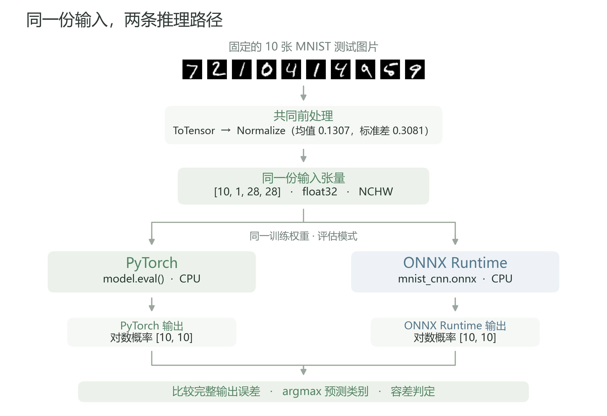 <!-- -->

<p align="center">图 2-20 同一份输入，两条推理路径</p>

图注：依据PyTorch官方MNIST示例及本节对照流程绘制。

固定图片经共同前处理后，分别送入同一训练权重对应的 PyTorch 评估模型和 ONNX Runtime CPU 会话，比较完整输出、预测类别及数值容差。

### 2.7.4 输出与预测类别

拿到输出后，需要先确定其中的数值表示什么。官方 MNIST 模型的最后一个全连接层为每张图片产生 10 个值，对应 10 个数字类别。`forward` 末尾的 `log_softmax(x, dim=1)` 沿类别维计算，返回各类别概率的自然对数，称为对数概率。输出形状因此为 `[批量数, 10]`。对这些值取指数可以还原概率，直接比较大小也可以选出模型最倾向的类别。本节将类别选择之前的完整对数概率数组称为“原始输出”。

本次 ONNX 的 `output` 节点对应这项 `log_softmax` 返回值，两侧实际输出都是 `[10, 10]` 的 `float32` 数组。元信息给出名称、形状和类型，导出时所选的返回值确定输出含义；两者共同用于把两个数组中相同位置对应到同一张样本、同一个类别。

要从完整输出中选出预测数字，可以查找每行最大值所在的列。输出中每行对应一张样本，10 列依次对应数字 0 至 9。数组的每个维度也称为轴，轴从 0 开始编号；这里的 `axis=1` 指第二个轴，沿它选择就能在每张图片的 10 个类别之间比较。

我们先将 PyTorch 输出转为 NumPy 数组，与 ONNX Runtime 输出核对形状，再沿类别轴取最大值的索引，比较两侧预测：

```python
torch_array = torch_output.detach().cpu().numpy()  # PyTorch完整输出转为数组
assert ort_output.shape == torch_array.shape       # 逐元素比较前核对形状
assert torch_array.ndim == 2                       # 核对本段的二维输出约定
torch_class = np.argmax(torch_array, axis=1)       # 每张样本的最大值类别索引
ort_class = np.argmax(ort_output, axis=1)
print("PyTorch类别", torch_class)
print("ONNX Runtime类别", ort_class)
```

`argmax` 返回每行最大值所在的列索引。MNIST 的类别按数字 0 至 9 排列，因此每张图片得到的索引就对应预测数字。原基线实验的结果为：

```text
PyTorch类别 [7 2 1 0 4 1 4 9 5 9]
ONNX Runtime类别 [7 2 1 0 4 1 4 9 5 9]
```

图 2-21 列出固定图片、真实标签与两侧预测，可以逐张观察类别是否对应。

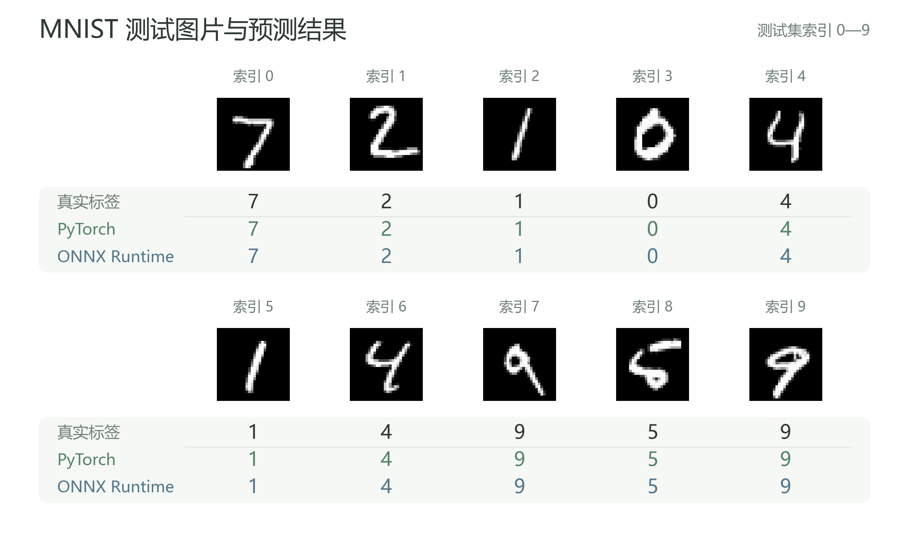 <!-- -->

<p align="center">图 2-21 固定10张MNIST测试图片与预测结果</p>

图注：图片取自MNIST测试集，预测来自本节Windows CPU对照结果。

按测试集索引 0—9 排列，PyTorch 与 ONNX Runtime 对这 10 张图片的预测逐项一致，且均与对应真实标签相同。

类别对照之后，我们继续查看测试集索引2的图片。它的真实标签和两侧预测都是1，表 2-13 列出完整的10维输出，类别号对应数组的列索引。这样既能观察最大值的位置，也能比较其他类别的数值：

<p align="center">表 2-13 单张样本的完整输出比较</p>

| 类别 | PyTorch 对数概率 | ONNX Runtime 对数概率 |
| --- | --- | --- |
| 0 | -18.0727214813 | -18.0727195740 |
| 1 | -3.69548115486e-6 | -3.81468998967e-6 |
| 2 | -15.8170318604 | -15.8170318604 |
| 3 | -20.1369876862 | -20.1369876862 |
| 4 | -13.1474514008 | -13.1474514008 |
| 5 | -17.6682472229 | -17.6682472229 |
| 6 | -15.7282772064 | -15.7282781601 |
| 7 | -13.3835334778 | -13.3835334778 |
| 8 | -17.1430206299 | -17.1430206299 |
| 9 | -20.5672950745 | -20.5672950745 |

类别 1 对应的值最大，接近 0，取指数后对应接近 1 的概率。表 2-13 保留便于阅读的有效数字；后面的误差统计使用保存的原始数组。

预测类别保留了最大值的位置，完整输出保留了各类别的数值。两个数组即使最大值落在同一位置，其余位置仍可能存在差异。因此，类别比较回答“选择了哪个数字”，数值比较回答“对应输出相差多少”。下面用这两个完整数组计算差异。

### 2.7.5 数值误差与一致性判断

两侧输出中的数值可能有微小差别。浮点数用有限位数表示数值，运算中的舍入与计算次序会影响结果。计算差异前，先核对两侧形状一致，让每个位置都对应同一张图片和同一个类别；还要检查所有值都是有限数值。NaN 表示无效数值，Inf 表示无穷大，本次比较要求两者都不出现。随后把保存的 32 位浮点输出转换为 64 位浮点数，再计算误差。转换保留原有输出值，误差计算使用更高精度。

令 ONNX Runtime 输出为 `a`，PyTorch 输出为参照 `b`，逐元素绝对误差为

$$
e_{\mathrm{abs}}=|a-b|
\tag{2-17}
$$
绝对误差表示两个对应数值相差多少。下面先核对已有输出的形状和有限值，再转换精度，计算这批输出中的最大逐元素绝对误差：

```python
assert ort_output.shape == torch_array.shape  # 每个位置对应同一张图片、同一类别
assert np.isfinite(ort_output).all() and np.isfinite(torch_array).all()  # 排除NaN和Inf
a = ort_output.astype(np.float64)   # 保留原float32值，使用float64计算差异
b = torch_array.astype(np.float64)  # PyTorch输出作为参照
abs_error = np.abs(a - b)           # 保留逐元素绝对误差
max_abs_error = np.max(abs_error)
print("最大绝对误差", max_abs_error)
```

本次 100 个输出值的最大绝对误差为 `7.62939453125e-6`。误差数组保留了差异的位置，查看其中一行即可沿类别维找出该样本各项输出的变化。

同一个绝对差放在不同数值尺度下，含义会有变化。以非零参考值为基准，相对误差写为

$$
e_{\mathrm{rel}}=\frac{|a-b|}{|b|},\qquad b\ne 0
\tag{2-18}
$$
相对误差将绝对差换算到参考值的尺度。参考值越接近零，微小的绝对差也越容易得到较大的比值。因此，本次仅对 `abs(b) > 1e-6` 的元素统计相对误差，其余元素单独检查绝对误差：

```python
relative_mask = np.abs(b) > 1e-6  # 参考值绝对值大于阈值的位置
near_zero = ~relative_mask       # 其余位置单独统计绝对误差
relative_error = abs_error[relative_mask] / np.abs(b[relative_mask])
print("相对误差统计元素数", relative_mask.sum())
print("最大相对误差", relative_error.max())
print("近零参考元素数", near_zero.sum())
print("近零部分最大绝对误差", abs_error[near_zero].max())
```

本次有96个元素参与相对误差统计，最大相对误差为`0.03225800100388251`，约3.23%。表 2-13 中类别1的参考值约为`-3.70e-6`，两侧绝对差约为`1.19e-7`，除以这个很小的参考值，就得到约3.23%的相对误差。另有4个元素的参考值绝对值小于或等于`1e-6`，它们的最大绝对误差为0。

得到误差后，还需要一条明确的规则判断差异是否在允许范围内。容差就是比较时允许的差异范围。本次在运行前选定绝对容差 `atol=1e-5`、相对容差 `rtol=1e-4`，用于这一模型和这批固定样本。NumPy 的 `allclose(a, b)` 将二者组合，逐元素判断

$$
|a-b|\leq \mathrm{atol}+\mathrm{rtol}|b|
\tag{2-19}
$$
`atol` 给出绝对尺度上的允许差异，`rtol` 按参考值大小增加允许差异。下面将 PyTorch 输出放在第二个参数作为参照，用 `allclose` 检查所有位置是否都满足这一条件。这里直接比较原始 `float32` 数组，前面的 `float64` 数组用于统计误差：

```python
rtol, atol = 1e-4, 1e-5  # 本次实验预设的组合容差
close = np.allclose(
    ort_output, torch_array, rtol=rtol, atol=atol,
    equal_nan=False  # NaN不按相等处理；前文已要求全部输出为有限值
)
print("容差条件是否满足", close)
```

本次得到 `True`，表示这批输出的所有对应元素都满足组合容差。

将这10张图片的输入、两侧输出和比较结果保存下来，就得到了本节的推理基线。后续更换运行设备或调整模型时，可以使用相同输入重新比较，观察预测类别和数值误差的变化。

## 2.8 面向硬件部署的模型接口

前节已经用同一批 MNIST 图片核对了 PyTorch 与 ONNX Runtime 的输出。继续部署时，我们还需要把输入的准备方法和输出的读取规则记录下来。模型接收什么数据、返回什么数值，以及这些数据怎样处理，共同构成模型接口。将它们写成接口说明，就能在后续部署中逐项核对。图 2-22 展示了当前模型与前后处理的关系。

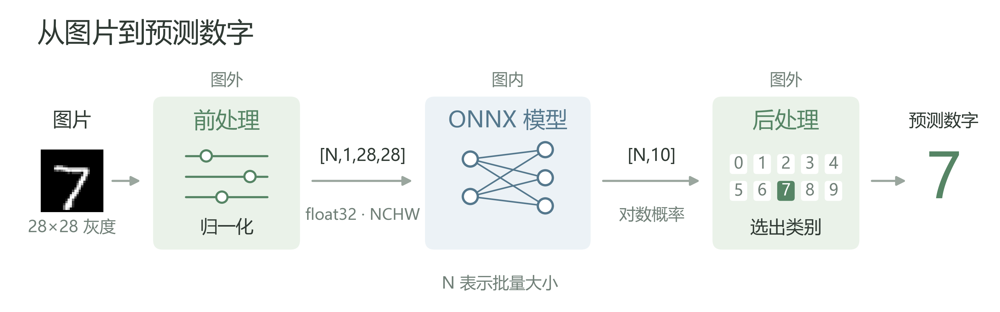 <!-- -->

<p align="center">图 2-22 MNIST 模型的前处理、输入输出与后处理边界</p>

图注：原创示意；数字图片取自 MNIST 测试集索引0，预测数字沿用前节同一样本的结果。

### 2.8.1 输入与前处理约定

输入说明需要从原始图片一直记录到模型收到的张量。MNIST 原生图片的高、宽均为28像素，只有一个灰度通道，因此通道栏填写“单通道灰度”。使用彩色模型时，还需要记录三个通道采用 RGB（红、绿、蓝）还是 BGR（蓝、绿、红）顺序，以便按模型要求准备各通道的数据。

除了通道，图片尺寸及其调整方式也需要记录。`Resize` 将图片调整到约定尺寸，`Crop` 从图片中截取约定区域。使用这些操作时，要写清先后次序、尺寸、缩放方法或裁剪区域的确定方式。当前模型直接使用原生28×28的 MNIST 图片，因此接口分别填写无 `Resize`、无 `Crop`，前处理从数值转换开始。

在本节的灰度图片路径中，原始像素用0至255的整数表示。`ToTensor`把它们除以255，并将单张图片组织为`[1,28,28]`的张量，再按前节的规则标准化。

处理后的图片按样本维组合成批次，输入形状为 `[batch, 1, 28, 28]`，沿用2.7的 NCHW 布局，即样本数、通道数、高、宽。接口需要区分允许变化的批量数与固定的通道、尺寸：`batch` 可以随批次改变，后面三维固定为1、28、28。

接下来还要明确前后处理由哪部分程序执行。表 2-14 记录了当前输入字段、处理次序及其与 ONNX 模型的关系。其中，名称、形状和类型沿用前节通过 ONNX Runtime 查询的字段；灰度、布局及标准化规则则结合模型源码和数据处理过程确定。

<p align="center">表 2-14 输入接口与前处理约定</p>

| 输入字段 | 当前 MNIST 约定 |
| --- | --- |
| 名称、类型 | `input`；`float32` |
| 模型形状、布局 | `[batch, 1, 28, 28]`；NCHW |
| 通道与尺寸 | 单通道灰度；原生28×28；无 `Resize`、`Crop` |
| 前处理次序 | `ToTensor` → `Normalize((0.1307,), (0.3081,))` → 组合批次 |
| 处理位置 | 前处理由调用程序在 ONNX 图外完成 |
| 本次固定输入 | `[10, 1, 28, 28]`，对应2.7的同一批样本 |

当前模型的 ONNX 图从卷积运算 `Conv` 开始，到 `LogSoftmax` 结束，图片转张量和标准化都由调用程序完成。我们据此安排部署中的处理顺序：先在图外准备符合约定的输入，再运行 ONNX 模型，取回完整输出后选择数字。

### 2.8.2 输出与后处理约定

输出说明既要记录数组的名称、类型和形状，也要说明其中的数值怎样对应到应用结果。列索引与类别含义之间的对应关系，称为类别表。形状相同的数组可以表达不同含义，因此还要记录输出的数值语义。

沿用2.7的结果读取方式，我们在 ONNX 图外对输出执行 `argmax(axis=1)`，再按类别表取得数字。这一后处理规则与输出字段一起记录在表 2-15 中，得到的预测顺序与输入图片顺序一致。

<p align="center">表 2-15 输出接口与后处理约定</p>

| 输出字段 | 当前 MNIST 约定 |
| --- | --- |
| 名称、类型、形状 | `output`；`float32`；`[batch, 10]` |
| 每行与每列 | 每行一张图片；十列依次对应数字0—9 |
| 数值语义 | `LogSoftmax` 给出的对数概率 |
| 类别表 | 列索引0—9 → 数字0—9 |
| 后处理及位置 | ONNX 图外沿 `axis=1` 取 `argmax`，再按类别表取得数字 |
| 本次参考输出 | 完整数组 `[10, 10]`；与2.7固定输入顺序一致 |

输入约定说明怎样把图片送入模型，输出约定说明怎样把返回值读成数字。后续部署时，我们可以沿同一份样本核对图片顺序、输出行和类别列，检查前后处理是否符合接口。

MNIST 的后处理围绕“每张图片选出一个数字”展开。任务要求找出物体位置、区分像素区域或读出文字时，输出需要保留的信息就会改变，读取规则也要随之调整。图 2-23 通过分类、检测、分割和文字识别，概括这些结果组织方式的差别。

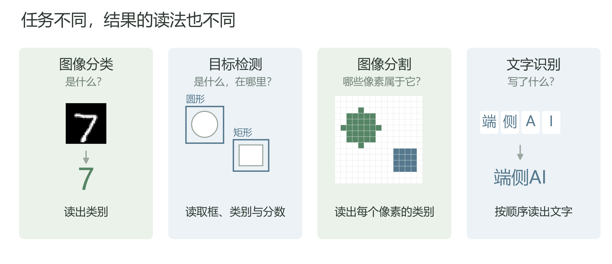 <!-- -->

<p align="center">图 2-23 分类、检测、分割和文字识别的结果组织方式</p>

图注：原创示意；分类图片取自 MNIST 测试集索引0，检测框、分割区域及字符排列为概念示意。

分类结果用于确定图片类别；检测结果需要将每个框与对应的物体名称、分数一起读取；分割结果按像素位置给出类别；文字识别结果则按字符次序组成字符串。接口说明应结合所用模型的实际输出，记录相应的字段、含义和读取规则。

## 本章小结

我们从MNIST手写数字图像和标签出发，规定了输入张量的轴、数据类型和标准化规则。卷积网络将每张图片变为十个类别的对数概率。训练时用真实标签计算损失并更新参数，再按验证结果选择权重，用独立的测试数据评价选定模型。

恢复训练结果需要同时保留模型定义、状态字典和前处理规则。推理时设置评估模式、关闭梯度记录，并核对图片的通道、尺寸及像素数值，才能按训练时的条件使用模型。ONNX将计算关系、参数及输入输出组织为共同表示，供推理引擎或厂商工具继续处理；部署前还需核对格式版本、算子支持和输入约束。以这些材料为基础，后续模型导出、数值对照和接口登记才能沿用明确的输入输出约定。

我们将训练得到的模型结构与权重导出为ONNX，读取模型实际的输入输出要求，并用同一批图片比较PyTorch与ONNX Runtime的预测类别和完整输出。基线对照确定后，输入的名称、形状、数据类型、前处理及输出语义共同构成后续部署所需的接口说明。沿用同一份输入和这些约定，可以继续检查模型在不同运行环境中的计算结果。

## 延伸阅读

完成模型保存与推理后，可以继续阅读[PyTorch模型保存与加载教程](https://docs.pytorch.org/tutorials/beginner/saving_loading_models.html)，重点查看状态字典的保存、模型恢复和跨设备加载，理解为什么恢复参数时仍需要相同的模型定义。结合[PyTorch v2.5.1的Module源码](https://github.com/pytorch/pytorch/blob/v2.5.1/torch/nn/modules/module.py)中`eval`的说明与[梯度模式源码](https://github.com/pytorch/pytorch/blob/v2.5.1/torch/autograd/grad_mode.py)中`no_grad`的说明，可以进一步区分模块运行模式与梯度记录。

图像数值处理可对照Torchvision 0.20的[ToTensor](https://docs.pytorch.org/vision/0.20/generated/torchvision.transforms.ToTensor.html)与[Normalize](https://docs.pytorch.org/vision/0.20/generated/torchvision.transforms.Normalize.html)文档，分别查看像素缩放的适用条件、输出张量的排列方式，以及按通道减均值、除标准差的计算规则。再结合[官方MNIST示例](https://github.com/pytorch/examples/blob/acc295dc7b90714f1bf47f06004fc19a7fe235c4/mnist/main.py)中的`transform`、`Net.forward`与`test`，追踪一张图片从前处理到类别选择的完整过程。

理解ONNX模型的组成后，可以阅读[ONNX v1.17.0 IR规范](https://github.com/onnx/onnx/blob/v1.17.0/docs/IR.md)，重点查看模型、计算图、初始化项和版本信息的定义，区分IR版本、算子集版本与模型自身版本。阅读时可将规范中的字段与表 2-8、表 2-10 对应，避免把几种版本号当作同一项要求。

[ONNX Runtime Python入门](https://onnxruntime.ai/docs/get-started/with-python.html)：可查看如何创建会话、送入NumPy数组并读取输出，将本节操作与官方完整示例对照。

[NumPy 1.23 allclose说明](https://numpy.org/doc/1.23/reference/generated/numpy.allclose.html)：可进一步查看组合容差公式、参考参数与近零数值的比较条件。

- PyTorch Contributors：[ToTensor（torchvision 0.19）](https://docs.pytorch.org/vision/0.19/generated/torchvision.transforms.ToTensor.html)与[Normalize（torchvision 0.19）](https://docs.pytorch.org/vision/0.19/generated/torchvision.transforms.Normalize.html)。用于查阅图片转张量、像素缩放与按通道标准化的具体条件。
- ONNX Runtime Contributors：[Python API summary](https://onnxruntime.ai/docs/api/python/api_summary.html)的 `InferenceSession.get_inputs`、`get_outputs` 与 `NodeArg` 条目。用于查阅输入输出名称、形状和类型的读取方法，实际使用的接口版本与项目环境保持一致。

## 本章参考文献

[1] LeCun Y, Cortes C, Burges C J C. The MNIST Database of Handwritten Digits. 数据集网站. <https://yann.lecun.org/exdb/mnist/>。

[2] Torchvision contributors. MNIST. Torchvision 在线文档. <https://docs.pytorch.org/vision/stable/generated/torchvision.datasets.MNIST.html>。

[3] PyTorch contributors. MNIST example. 官方仓库示例，提交 acc295dc7b90714f1bf47f06004fc19a7fe235c4. <https://github.com/pytorch/examples/tree/acc295dc7b90714f1bf47f06004fc19a7fe235c4/mnist>。

[4] PyTorch contributors. Conv2d. PyTorch 在线文档. <https://docs.pytorch.org/docs/stable/generated/torch.nn.Conv2d.html>。

[5] PyTorch contributors. LogSoftmax. PyTorch 在线文档. <https://docs.pytorch.org/docs/stable/generated/torch.nn.LogSoftmax.html>。

[6] LeCun Y, Bottou L, Bengio Y, Haffner P. Gradient-Based Learning Applied to Document Recognition. Proceedings of the IEEE, 1998, 86(11): 2278–2324. <https://doi.org/10.1109/5.726791>；<https://cs.nyu.edu/~yann/2010f-G22-2565-001/diglib/lecun-98.pdf>。

[7] PyTorch contributors. Saving and loading models. PyTorch 在线教程. <https://docs.pytorch.org/tutorials/beginner/saving_loading_models.html>。访问日期：2026-11-08。

[8] PyTorch contributors. PyTorch 模块与梯度模式. v2.5.1 官方仓库源码，Module 的 state_dict、load_state_dict、eval 及 no_grad. <https://github.com/pytorch/pytorch/blob/v2.5.1/torch/nn/modules/module.py>；<https://github.com/pytorch/pytorch/blob/v2.5.1/torch/autograd/grad_mode.py>。访问日期：2026-11-08。

[9] Torchvision contributors. Torchvision 图像变换. 0.20 在线文档，ToTensor 与 Normalize 条目. <https://docs.pytorch.org/vision/0.20/generated/torchvision.transforms.ToTensor.html>；<https://docs.pytorch.org/vision/0.20/generated/torchvision.transforms.Normalize.html>。访问日期：2026-11-08。

[10] ONNX contributors. Open Neural Network Exchange Intermediate Representation specification. v1.17.0 官方仓库文档. <https://github.com/onnx/onnx/blob/v1.17.0/docs/IR.md>。访问日期：2026-11-08。

[11] ONNX Runtime contributors. ONNX Runtime 在线文档. 概览与 Python 入门. <https://onnxruntime.ai/docs/>；<https://onnxruntime.ai/docs/get-started/with-python.html>。访问日期：2026-11-08。

[12] airockchip. RKNN-Toolkit2. 官方仓库. <https://github.com/airockchip/rknn-toolkit2>。访问日期：2026-11-08。

[13] 海思. SVP NPU 快速上手指南. Hi3516CV610 在线文档. <https://docs.hisilicon.com/projects/Hi3516CV610/main/tools/SVP_NPU/快速上手指南/快速上手指南.html>。访问日期：2026-11-08。

[14] ONNX contributors. ONNX operator schemas. ONNX 在线算子文档. <https://onnx.ai/onnx/operators/index.html>。

[15] PyTorch contributors. PyTorch 官方文档、示例与源码. MNIST 示例（提交 acc295dc7b90714f1bf47f06004fc19a7fe235c4）、ONNX 导出（v2.4.1）、评估模式、梯度模式（v2.4.1）、log_softmax、Tensor.numpy、Tensor.detach 与数值精度（v2.4.1）. <https://github.com/pytorch/examples/blob/acc295dc7b90714f1bf47f06004fc19a7fe235c4/mnist/main.py>；<https://github.com/pytorch/pytorch/blob/v2.4.1/torch/onnx/utils.py>；<https://docs.pytorch.org/docs/main/generated/torch.nn.Module.html#torch.nn.Module.eval>；<https://github.com/pytorch/pytorch/blob/v2.4.1/torch/autograd/grad_mode.py>；<https://docs.pytorch.org/docs/main/generated/torch.nn.functional.log_softmax.html>；<https://docs.pytorch.org/docs/stable/generated/torch.Tensor.numpy.html>；<https://docs.pytorch.org/docs/stable/generated/torch.Tensor.detach.html>；<https://github.com/pytorch/pytorch/blob/v2.4.1/docs/source/notes/numerical_accuracy.rst>。访问日期：2026-11-07。

[16] ONNX Runtime contributors. ONNX Runtime 在线文档与源码. Python API 与 v1.20.1 推理会话源码. <https://onnxruntime.ai/docs/api/python/api_summary.html>；<https://github.com/microsoft/onnxruntime/blob/v1.20.1/onnxruntime/python/onnxruntime_inference_collection.py>。访问日期：2026-11-07。

[17] Torchvision contributors. Torchvision 在线文档与源码. ToTensor、Normalize（0.19），变换函数、MNIST 数据集、检测模型、分割模型及分割输出结构（v0.19.1）. <https://docs.pytorch.org/vision/0.19/generated/torchvision.transforms.ToTensor.html>；<https://docs.pytorch.org/vision/0.19/generated/torchvision.transforms.Normalize.html>；<https://github.com/pytorch/vision/blob/v0.19.1/torchvision/transforms/functional.py>；<https://github.com/pytorch/vision/blob/v0.19.1/torchvision/datasets/mnist.py>；<https://github.com/pytorch/vision/blob/v0.19.1/torchvision/models/detection/faster_rcnn.py>；<https://github.com/pytorch/vision/blob/v0.19.1/torchvision/models/segmentation/fcn.py>；<https://github.com/pytorch/vision/blob/v0.19.1/torchvision/models/segmentation/_utils.py>。访问日期：2026-11-07。

[18] NumPy developers. numpy.allclose. NumPy 1.23 在线文档. <https://numpy.org/doc/1.23/reference/generated/numpy.allclose.html>。访问日期：2026-11-07。

[19] Goldberg D. What every computer scientist should know about floating-point arithmetic. ACM Computing Surveys, 1991, 23(1): 5–48. <https://doi.org/10.1145/103162.103163>。

[20] PaddlePaddle contributors. rec_postprocess.py. PaddleOCR v2.8.1 官方仓库源码. <https://github.com/PaddlePaddle/PaddleOCR/blob/v2.8.1/ppocr/postprocess/rec_postprocess.py>。访问日期：2026-10-16。
